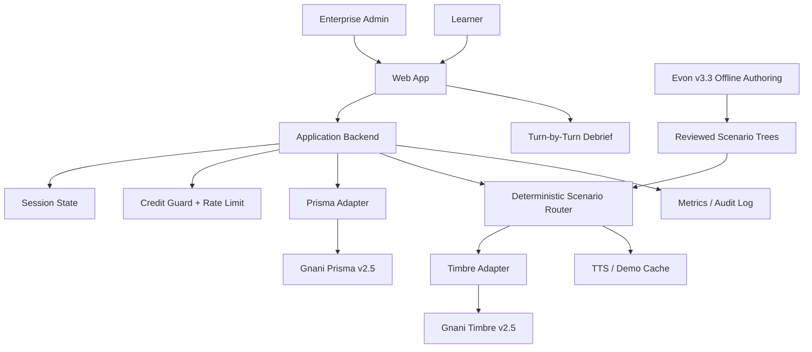
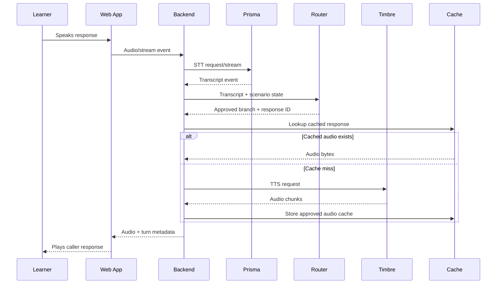
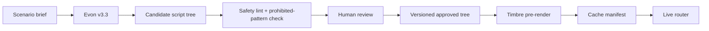

## 0. Header block

# Great Indian AI Internship Challenge — Execution Roadmap

**Project:** Vishing Vaccine (working title)

**Date:** Friday, 2026-10-02  
**Version:** 1.1  
**Status:** Execution-ready, pending organizer/API verification gates

**Implementation milestone — 2026-10-26:** Phase 5A–5F and overall Phase 5 **COMPLETE**. Fresh user-reported SAFE_VERIFIED and MAX_TURNS paths match offline expectations, with automatic terminal playback, no extra learner listening turn and microphone indicator cleanup confirmed. See the [Phase 5 final acceptance record](docs/evidence/phase5-final-acceptance.md) for validation, observed evidence and limits. Phase 6 has **not started**. The dated planning assumptions below remain historical.

**Implementation milestone — 2026-11-06:** Phase 6A **COMPLETE**. The local authoring CLI generates and imports validated drafts, and the Authoring page previews saved records. Phase 6B has not started. [Phase 6A evidence and walkthrough](docs/evidence/phase6a-mock-authoring-import.md)

**Implementation milestone — 2026-11-07:** Phase 6B **COMPLETE**. Automated validation reports precise findings and binds review eligibility to current content, validator version and local safety configuration. S-90/S-91 each have zero errors and two human-review warnings while retaining DRAFT status. Phase 6C has not started. [Phase 6B evidence](docs/evidence/phase6b-safety-schema-validation.md)

**Implementation milestone — 2026-11-08:** Phase 6C engineering and handoff **COMPLETE; HUMAN REVIEW PENDING**. Local review/checklist/warning/approval/revision/audit/publication gates are tested offline. The owner's changes were recorded against preserved S-92 v0.1.0; new S-92 v0.1.1 is an unsubmitted DRAFT with PASS validation, zero errors/warnings and no human decisions, approval or publication. S-01 runtime and original S-90/S-91 remain unchanged. New-candidate publication remains incompatible with the current runtime. Phase 6D and 6E **NOT STARTED**. [Evidence and manual guide](docs/evidence/phase6c-human-review-approval.md), [exact review packet](docs/evidence/phase6c-review-packet-S92-v0.1.1.md)

**Phase 6D final acceptance — 2026-11-09. COMPLETE.** The server authorizes runtime from the fingerprint-bound S-01 release and verified successful journal publications. Sessions pin exact release identities. A disposable publication passed all 79 graph prefixes and 66 leaves and executed through typed practice. Ten new isolation tests passed within the 1,185-test full check. Protected fingerprints match and real provider calls were zero. S-92 remains APPROVED and runtime-ineligible with its historical publication block. Phase 6E **NOT STARTED**. [Runtime isolation evidence](docs/evidence/phase6d-runtime-isolation.md)

**Phase 6E final acceptance — 2026-11-09. COMPLETE.** Mock generation and manual import independently reached validation, test review, explicit publication, typed practice and debrief in disposable stores. Browser lineage and runtime isolation passed. S-01 remains the only real-workspace playable scenario. S-92 remains approved and runtime-ineligible with its historical publication block. The future Evon authoring adapter is documented. [Acceptance report and offline guide](docs/evidence/phase6e-end-to-end-acceptance.md)

**Status legend**

**Phase 6C final acceptance — 2026-11-08: COMPLETE.** The owner approved exact S-92 v0.1.1 hash 7d2806433a6b9641c5eaacca23570fa73c8973ca736d90b23d2e88140a360337 after current validation and checklist confirmation. One separately authorized publication attempt was PUBLICATION_BLOCKED by seven actual compatibility reasons. Approval remains intact, runtime eligibility false; fresh CLI processes preserve approval and publication audit records. Final full check1175/1175, diff and protected fingerprints pass; zero real provider calls. S-01 and original drafts remain unchanged. Phase 6D **NOT STARTED**. [Final acceptance and exact reasons](docs/evidence/phase6c-human-review-approval.md#final-acceptance--genuine-approval-and-controlled-publication)

- `[VERIFIED src]` = checked against a primary/current source on 2026-10-02; source URL is recorded in Appendix H.
- `[VERIFIED supplied source]` = directly grounded in the contest terms supplied with this roadmap request.
- `[UNVERIFIED]` = not established by a primary source yet; do not present it as fact in product copy or submission copy.
- `[ASSUMPTION]` = planning assumption used to keep the schedule executable.
- `[DECISION]` = pre-decided execution choice; reversal trigger is stated in the Decision Log.

> **Evidence discipline:** no benchmark, pricing, API response field, legal conclusion, impact statistic, or judge preference is treated as fact unless a cited primary source supports it or the roadmap labels it `[UNVERIFIED]` and assigns a verification task.

---

## Table of contents

0. [Header block](#0-header-block)
1. [Next 48 hours](#1-next-48-hours)
2. [Executive summary](#2-executive-summary)
3. [Compliance matrix](#3-compliance-matrix)
4. [Assumptions and unknowns register](#4-assumptions-and-unknowns-register)
5. [Product definition](#5-product-definition)
6. [System architecture](#6-system-architecture)
7. [Credits and cost plan](#7-credits-and-cost-plan)
8. [Tech stack and repository plan](#8-tech-stack-and-repository-plan)
9. [Content and data plan](#9-content-and-data-plan)
10. [Evaluation and measurement plan](#10-evaluation-and-measurement-plan)
11. [Safety, ethics, legal and compliance](#11-safety-ethics-legal-and-compliance)
12. [Schedule](#12-schedule)
13. [Scope-cut and fallback ladder](#13-scope-cut-and-fallback-ladder)
14. [Demo and storytelling](#14-demo-and-storytelling)
15. [Distribution and engagement plan](#15-distribution-and-engagement-plan)
16. [Submission and workspace checklist](#16-submission-and-workspace-checklist)
17. [Testing and QA plan](#17-testing-and-qa-plan)
18. [Risk register](#18-risk-register)
19. [Decision log](#19-decision-log)
20. [Interview and internship preparation](#20-interview-and-internship-preparation)
21. [Appendices](#21-appendices)

---

# 1. Next 48 hours

**Window:** Fri 2026-10-02 through Sun 2026-10-04.  
**Objective:** remove the unknowns that can invalidate the concept before significant code is written.

| Order | Task | Time | Why now | Owner | Dependency | Acceptance |
|---|---|---:|---|---|---|---|
| 1 | **T-001 — Send bundled organizer questions for G-01/G-02/G-07/G-08/G-09** | 0.75 h | Evon access, credits, eligibility, reuse and scoring affect the entire architecture and submission strategy. | Solo | none | Discord/email drafts sent; sent timestamp and message text saved. |
| 2 | **T-002 — Create participant account/workspace and inspect credit dashboard** | 0.75 h | The dashboard is the fastest path to evidence about the real contest API path and usage meter. | Solo | registration access | Workspace opened; credit display, API onboarding and team fields recorded. |
| 3 | **T-003 — Capture current contest terms/page as evidence** | 0.5 h | Preserve a dated copy/screenshot/PDF of the page and terms for later reconciliation if wording changes. | Solo | current contest page | Dated evidence copy saved with source URL and access date. |
| 4 | **T-004 — Run Prisma smoke matrix**: Hindi, English, candidate second language, code-mixed phrases, numerals, alphanumerics, 8 kHz | 2.0 h | Prisma is the live input path; failure here means the product must pivot before UI investment. | Solo | initial API access; G-04 | Test sheet contains raw expected text and returned transcript for every case; failures are logged. |
| 5 | **T-005 — Run Timbre voice audition** for Hindi, English and candidate second language; test Hinglish voice | 1.5 h | Voice quality and allowed use directly determine demo credibility and scenario language. | Solo | initial API access; G-03 | Selected voices produce playable clips; language/voice/sample-rate metadata and quality notes saved. |
| 6 | **T-006 — Measure one real turn end-to-end** with scripted speech → Prisma → routing → Timbre | 1.5 h | G-05 needs a measured latency baseline before an architectural target can be locked. | Solo | T-004, T-005 | At least 5 timed turns recorded with stage timestamps and no-secrets trace. |
| 7 | **T-007 — Verify Evon access/serving path and run a tiny latency test** | 2.0 h | Evon may only remain in the live path if its access path and measured latency are practical. | Solo | G-01 access evidence | Access path, hardware/serving method, one measured generation trace and go/no-go note saved. |
| 8 | **T-008 — Freeze initial scenario taxonomy and three candidate scenario briefs** | 1.0 h | Prevents the team from drifting into an operational scam-playbook or an overbroad content set. | Solo | contest safety terms | Three briefs each contain learning objective, red flags, fictional entity and safe fallback. |
| 9 | **T-009 — Decide provisional repo boundary and record it in D-02** | 0.5 h | A new repo minimizes prior-work/plagiarism risk while keeping generic UI reuse possible if G-07 permits it. | Solo | existing-asset inventory; G-07 pending | D-02 recorded; no existing file modified; reuse list marked pending approval. |
| 10 | **T-010 — Establish the evidence ledger and experiment log** | 0.75 h | Every benchmark, model version, API response, participant count and demo claim must be reproducible. | Solo | none | Ledger template has fields for source, date, model, input, result, metric, caveat and artifact path. |

**48-hour exit criteria:** G-01–G-05 have an initial evidence state; G-07/G-08/G-09 questions are sent; Prisma/Timbre smoke evidence is saved; no application code has been written into the roadmap workspace by this task.

---

# 2. Executive summary

## 2.1 One-paragraph pitch

**Vishing Vaccine** is a B2B voice-based scam-call training simulator for bank, insurer, telecom and enterprise security/fraud-awareness teams. An enterprise admin selects a scenario, language and risk theme; a learner receives a clearly labeled AI-generated simulated call using a fictional organization; Prisma transcribes the learner's spoken response; deterministic scenario routing chooses the next branch; Timbre voices the simulated caller; and the session ends with a turn-by-turn debrief showing which observable behaviors reduced risk. Evon is used primarily offline to author and refine branching scenario trees and debrief language, with a controlled live-loop trial only if G-01/G-05 demonstrate acceptable access and latency. The product deliberately uses fictional entities, dummy secrets, visible `SIMULATION` and `AI-generated voice` disclosures, consent-before-recording, no default audio retention, and no instructions for evading real security controls. The contest terms require a working application using Gnani AI models/APIs for a practical need for enterprises, developers or creators; the proposed product is explicitly B2B and documents its Gnani usage and contributions. `[VERIFIED supplied source]`

## 2.2 25-word pitch

**Train employees to recognize voice scams through safe, multilingual simulated calls, then show exactly which risky responses occurred—without using real brands, credentials, or stored recordings.**

## 2.3 What the project is / is not

| In scope | Deliberately not built |
|---|---|
| Enterprise-admin scenario selection | Real bank, police, RBI, CBI or telecom impersonation |
| Learner voice-first simulated call | Real OTP/PIN/card/account data |
| Prisma STT; Timbre TTS; Evon for offline content/review | A general-purpose autonomous scam bot |
| Hindi + one second language selected from test evidence | Ten-language surface area without evidence |
| 3 scenarios × 2 languages | Large scenario library before core quality is stable |
| Turn-by-turn safety debrief | Fabricated enterprise analytics or invented efficacy claims |
| Telephony-degraded test set | Claims of real-world accuracy from synthetic-only round trips |
| Optional developer scenario-pack concept | Public autonomous call blasting or cold outreach |
| Scenario safety/content review | Letting unsafe or incomplete scenario branches reach the demo |

## 2.4 Why it satisfies the contest terms

- The buyer is an enterprise fraud-awareness/L&D/security function, not a consumer-only audience. `[VERIFIED supplied source; project framing]`
- The solution uses Gnani AI technology in a central feature path: Prisma for learner speech, Timbre for simulated caller voice, and Evon for offline scenario/debrief generation where validated. `[VERIFIED supplied source; current docs for Prisma/Timbre/Evon support]`
- The project demonstrates a practical enterprise training use case and provides a public working demo as required. `[VERIFIED supplied source]`
- The entry is designed around regional language and code-mixed voice because the current contest page explicitly lists the Main Character and Mixed Vibes awards. `[VERIFIED src]`
- The demo is real and labeled; no purchased engagement, bots, paid promotion, engagement exchanges, plagiarism, or misleading demonstration is part of the plan. `[VERIFIED supplied source]`

---

# 3. Compliance matrix

| Contest term | How Vishing Vaccine satisfies it | Evidence artifact | Residual risk | Action |
|---|---|---|---|---|
| **01 — Who can participate** | Register as one eligible student or team of two; both members have accurate college details; teammate acceptance handled per organizer flow. `[VERIFIED supplied source]` Current public page says enrolled in a degree/course at a college/university in India, 18+, solo or one teammate. `[VERIFIED src]` | Registration confirmation; workspace profile; dated eligibility screenshot; teammate acceptance record if duo | Exact definition and town/category wording must be confirmed. | Pass **G-08** by 2026-10-04; do not submit until eligibility evidence exists. |
| **02 — Build and demonstrate** | Working B2B application; explicit Gnani model/API list; enterprise buyer + learner defined; each contribution documented; demo + written explanation + post links. `[VERIFIED supplied source]` | Working URL or recorded demo; README; architecture; workspace description; contribution ledger | Evon access path/credits and live latency may force a reduced model role. | Pass **G-01/G-02/G-04/G-05/G-07** before architecture freeze. |
| **03 — Share your working demo** | Public working video on LinkedIn and/or X; identify Gnani tech; tag official Gnani account; include `#GnaniAI` and `#GreatIndianAIInternshipChallenge`; nominate one post per platform. `[VERIFIED supplied source]` | Final post URLs; screenshots; submission workspace nomination evidence | Exact close/cutoff and what engagement is counted is not public on current page. | Pass **G-09**; post target 2026-11-04 to 2026-11-06, subject to cutoff evidence. |
| **04 — How shortlisting works** | Entry is built around a working project, public demo, submission review and documented Gnani usage. `[VERIFIED supplied source; VERIFIED src]` | Dated metrics/evidence sheet; final submission receipt; nominated post snapshot | Exact scoring formula, engagement window and weighting not visible on current public page. | **G-09** must resolve scoring mechanics before final distribution strategy. |
| **05 — Keep participation authentic** | Organic distribution only; no bought engagement, bots, engagement exchanges, paid promotion, plagiarism or misleading demo steps. `[VERIFIED supplied source]` | Distribution checklist; post copy; demo provenance log; clean commit history | External people may create invalid interactions outside the team's control. | Never request reciprocal engagement; retain copies/screenshots; use only genuine feedback requests. |
| **06 — Internship selection and stipend** | Roadmap treats internship as a downstream possibility, not a promised outcome; contribution evidence is recorded per person. Current public page says offers are individual and only written offers confirm them. `[VERIFIED supplied source; VERIFIED src]` | Individual contribution ledger; architecture notes; experiment ownership; interview prep | No guarantee of internship or stipend amount. | Do not claim selection odds, ranking, or guaranteed compensation in promotion. |
| **07 — Key dates and changes** | Final submission is targeted for 2026-11-07, at least 3 days ahead of the stated 2026-11-10 close; internship start recorded as 2027-01-01. `[VERIFIED supplied source; VERIFIED src]` | Calendar; rehearsal receipt; final submission receipt | Exact cutoff time/timezone and organizer changes are unknown. | Pass **G-09** and re-check the official page on 2026-11-06. |

## 3.1 Award-targeting plan

The current public contest page lists **ten** awards and states that no individual/team can win more than one. `[VERIFIED src]` The supplied earlier terms described an awards-count mismatch; the current page resolves that mismatch by listing all ten. Keep G-09 anyway because the organizer's scoring/cutoff mechanics remain incomplete.

| Award | Pursuit status | Product proof required | Claim rule |
|---|---|---|---|
| Main Character — regional/low-resource language | **Pursue** | Real end-to-end experience in the selected regional language; disclose exact language tested. | Only claim based on recorded working evidence. |
| Mixed Vibes — code-mixed voice | **Pursue** | Working Hinglish or another supported code-mixed path; test set with representative phrases. | Do not claim universal code-mix accuracy. |
| Real Deal — real-world problem | **Pursue** | Concrete enterprise training problem, consenting pilot and true participant count. | No invented ROI or reduction claims. |
| Noise Canceller — noisy telephonic audio | **Partial / conditional** | Real 8 kHz/phone-quality tests and reported error/latency. | Claim only after measured tests. |
| Two-Person Army | **Conditional on duo** | Clearly separated member contributions and joint working demo. | No team-size claim before G-08. |
| Solo Ninja | **Conditional on solo** | One-person contribution record. | Do not present a solo build if a collaborator materially built it. |
| Jugaad Genius — creativity | **Pursue** | Distinctive scenario/debrief interaction and defensible architecture trade-off. | Descriptive only; do not assert “most creative.” |
| Small Town, Big Build | **Uncertain / verify** | Organizer definition of “Tier 2/Tier 3 college or city.” | Do not plan product scope around it; do not self-label without G-08. |
| Demo Day Drop — 60-second demo | **Pursue** | A real 60-second public demo, polished and technically legible. | No fake live steps; pre-rendered elements must be disclosed. |
| Crowd Favourite | **Pursue only through organic reach** | One nominated LinkedIn post and/or X post with required tags/hashtags; genuine audience response. | No voting manipulation, paid promotion, engagement exchange, or bots. |

**One-award rule:** even if multiple categories appear relevant, the entry must not imply or ask for multiple awards; the organizer states that no individual or team can win more than one award. `[VERIFIED supplied source; VERIFIED src]`

---

# 4. Assumptions and unknowns register

## 4.1 Gates G-01–G-12

| Gate | Question | Exact verification method | Pass criteria | Fail criteria | Deadline | Owner | Pre-decided fallback |
|---|---|---|---|---|---|---|---|
| **G-01** | **Evon access path, hardware and live latency** | Check participant workspace/console; inspect current Evon HF card; ask organizer whether contest credits can call Evon; run one real generation and measure p50/p95 time-to-first-token / completion for the intended prompt; record hardware and memory if self-hosted. | A supported access path exists; serving route is legally/contest-safe; measured per-turn latency is compatible with G-05; or offline generation is reliable. | No credit-backed path and local/rented serving is impractical inside schedule/budget, or live latency breaks G-05. | **2026-10-05** | Solo | Remove Evon from live path; use offline-generated, human-reviewed scenario trees and deterministic routing. |
| **G-02** | **What do 5,000 credits measure? Cost/call, rate limits, expiry** | Inspect dashboard and official docs; make one controlled STT and one TTS call; record before/after credits; ask organizer to confirm unit, rate, expiry and rate limits. | Metering unit is known for STT/TTS and any eligible LLM path; limits and expiry are recorded. | Any critical meter/rate/expiry remains unknown. | **2026-10-05** | Solo | Set an internal conservative call cap; use cached TTS/demo mode; no public link until guard is implemented. |
| **G-03** | **Timbre languages/voices/quality/policy** | Use current voice catalog and TTS docs; audition candidate voices in Hindi, English, and two regional-language candidates; ask Gnani to confirm acceptable simulation/impersonation-style content. | Two chosen languages have acceptable voice quality, supported settings and policy clearance. | A language/voice is unavailable, materially poor, or policy-restricted. | **2026-10-04** | Solo | Choose another documented language/voice; if only Hindi+English survive, build those and keep language claims narrow. |
| **G-04** | **Prisma host/auth/language codes/code-mix/timestamps/confidence/streaming choice** | Verify participant key format and host in dashboard/docs; run REST + WebSocket smoke tests; run numeral/alphanumeric test set; inspect actual response schema; ask organizer which endpoint consumes contest credits. | Contest-funded path is known; language codes are verified; live transcript and metadata are understood; one path chosen. | Contest key/path differs from docs or needed fields are absent/unusable. | **2026-10-05** | Solo | Server-side REST STT for turn clips; if response metadata lacks timestamps/confidence, debrief uses deterministic turn numbers only. |
| **G-05** | **End-to-end turn latency** | Instrument learner speech-end to first playable scammer audio byte for ≥30 controlled turns across chosen languages and at least one 8 kHz path; record p50/p95. | **Target:** p50 ≤ 1.2 s and p95 ≤ 2.0 s from speech-end to first audio; target is a planning assumption informed by documented sub-200 ms STT/TTS streaming capability, not a promised benchmark. **Hard fail:** p95 > 3.0 s or >10% turns >3.0 s. | Hard-fail threshold exceeded or experience is visibly broken. | **2026-10-12** | Solo | Move all non-deterministic reasoning offline; use deterministic routing + cached short Timbre utterances; if still failing, Level 2/3 scope and recorded demo. |
| **G-06** | **Scenario safety/content gate** | Run a full red-team review over every scenario branch in both selected languages; scan for real organizations, real credentials, operational scam instructions, unsafe persuasion and missing safe fallbacks; manually approve the final branch set. | All release branches pass the safety checklist; every branch has a safe fallback and learning objective; no real entity/credential content remains. | Any unsafe, misleading or incomplete branch remains unresolved at content freeze. | **2026-10-31** | Solo | Remove the affected scenario/language branch from the release; fall back to the smallest fully reviewed scenario set. |
| **G-07** | **Is disclosed reuse of earlier code/assets allowed?** | Send written question to `internshipscontest@gnani.ai` and Discord; retain reply; ask specifically about reusable UI primitives/design tokens and prior ML code. | Written answer explicitly permits the planned reuse and disclosure. | Reuse is prohibited, restricted, or unclear by final freeze date. | **2026-10-06** | Solo | No prior-code reuse. Recreate needed UI using only newly written components and properly licensed/open-source dependencies. |
| **G-08** | **Eligibility, Tier 2/3 definition, team registration** | Read current registration terms; inspect team flow; ask organizer to define eligibility and Tier 2/3 award geography. | Eligibility and team state documented; award meaning understood. | Required status cannot be evidenced. | **2026-10-05** | Solo | Enter only after eligibility is verified; do not rely on Tier 2/3 award. |
| **G-09** | **Scoring method, cutoff time/timezone, engagement weighting, teaser-post rules, tenth award** | Read the official program page/registration terms immediately before final campaign; ask organizer for exact cutoff timestamp/timezone and scoring mechanics. | Exact cutoff time/timezone and engagement window recorded; current award count verified; nomination rule confirmed. | Any critical deadline/scoring element remains ambiguous. | **2026-11-06** | Solo | Submit by 2026-11-07 and treat all posts as potential evidence but nominate exactly one per platform; re-check page again before posting. |
| **G-10** | **Gnani data retention/training and consent needs** | Read Gnani privacy policy and any API data-use terms tied to the contest key; ask whether audio/text is retained or used for training; record answer in consent log. | Retention/training statement is documented; learner notice matches actual processing. | Data-use terms remain unclear. | **2026-10-08** | Solo | Do not store learner audio; send minimal text/audio; use local ephemeral buffers and demo mode; obtain explicit consent before any recording. |
| **G-11** | **Public link safe and judge-accessible?** | Deploy a private/staged endpoint first; test access code, rate limit, credit guard, abuse handling and API failure mode with 20 synthetic sessions. Ask organizer what judges can access. | Safe public demo works or video/local demo is explicitly accepted. | Public endpoint can burn credits, reveal secrets, or is unreliable. | **2026-10-27** | Solo | Use a recorded 60-second demo + controlled demo access code; no unrestricted public live API. |
| **G-12** | **Solo vs duo and weekly hours** | Make explicit commitment based on available hours; if duo, document ownership before any code merge. | One track chosen and recorded; weekly capacity maps to scope tier. | No stable capacity. | **2026-10-04** | Solo | Default to solo + medium/low scope rather than introducing coordination risk. |

## 4.2 Assumptions used to keep the plan executable

| Assumption | Value used | Why | Verification / reversal |
|---|---|---|---|
| **A-01** | `[ASSUMPTION]` Default execution is solo unless a second contributor is explicitly registered and can sustain weekly work. | Avoids coordination overhead while preserving a duo path. | G-12 by 2026-10-04. |
| **A-02** | `[ASSUMPTION]` Three capacity tiers: low ≈10 h/week, medium ≈20 h/week, high ≈30 h/week. | Required by the roadmap brief; no invented personal schedule. | Replace only with G-12 evidence. |
| **A-03** | `[ASSUMPTION]` Development machine is a consumer NVIDIA-GPU class system; exact available VRAM and performance are not treated as sufficient to host Evon until measured. | Keeps self-hosting as a test path without assuming feasibility. | G-01. |
| **A-04** | `[ASSUMPTION]` Hindi is the anchor language because it is supported in the current Prisma/Timbre docs; second language is chosen by G-03/G-04 evidence and award fit. | Avoids arbitrary language choice. | G-03/G-04. |
| **A-05** | `[ASSUMPTION]` One 60-second demo is the primary narrative surface; all major work must appear there, in pilot evidence, or in compliance artifacts. | Enforces demo-driven scope. | D-04 reversal only if judge requirements change. |
| **A-06** | `[ASSUMPTION]` End-to-end target p50 ≤1.2 s / p95 ≤2.0 s, hard fail >3.0 s. | A practical product target, not a claim about Gnani. | G-05. |
| **A-07** | `[ASSUMPTION]` Public live demo may be restricted by an access code; if organizers require unrestricted judge access, G-11 decides the final mode. | Protects credits and prevents abuse. | G-11. |
| **A-08** | `[ASSUMPTION]` Volunteer pilot target N=12 completed participants, with at least 6 bilingual/code-mixed users if available. | Small but usable for qualitative/operational validation; not a population claim. | T-043/T-044; if recruitment fails, report true N and caveat. |
| **A-09** | `[ASSUMPTION]` New repository is the default to minimize prior-work risk. | Separates contest artifact from prior project history. | G-07 by 2026-10-06. |
| **A-10** | `[ASSUMPTION]` Candidate second languages start as Marathi and Tamil because the current Timbre catalog includes both and Prisma docs list both; no quality winner is assumed. | Provides two testable candidates. | G-03/G-04. |

## 4.3 Verified external facts that changed the earlier working assumptions

- The current Vercel sources state that WebSockets on Vercel Functions entered public beta in June 2026, and a current Vercel guide demonstrates WebSockets on Vercel Functions. This **supersedes** the older “Vercel cannot hold WebSockets” working assumption in the supplied project notes. `[VERIFIED src]` The roadmap still keeps the real-time voice backend separate initially because stable, contest-focused infrastructure and a single controlled deployment surface reduce moving parts; this is a decision, not a Vercel impossibility claim.
- The current Gnani contest page lists **ten** awards explicitly, including the Crowd Favourite award. `[VERIFIED src]` The earlier supplied observation about nine categories is therefore preserved only as historical context and no longer treated as a current page fact.
- Current Gnani speech docs expose `api.vachana.ai` with `X-API-Key-ID` authentication. `[VERIFIED src]` Whether the contest's 5,000 credits use precisely this path remains a G-04/G-02 question.

---

# 5. Product definition

## 5.1 Personas

### Persona P-01 — Enterprise admin

Role: fraud-awareness lead, L&D manager, security-awareness lead or enterprise training owner.

Job to be done: configure a short scenario, select language, assign target behaviors, run a training session, and inspect a factual debrief without collecting unnecessary voice data.

Success condition: can launch a scenario in under two minutes, understand what the learner was evaluated on, and export a debrief without needing model expertise.

### Persona P-02 — Learner

Role: bank/insurer/telecom/enterprise employee or customer participating in training.

Job to be done: answer a suspicious simulated call naturally using speech and learn from the result.

Success condition: understands the simulation, does not disclose real secrets, can follow along in mobile/low-bandwidth conditions, and receives concrete turn-based feedback.

## 5.2 End-to-end user journeys

### J-01 — Admin configures a scenario

1. Sign in / enter admin demo mode.
2. Pick one of three approved scenarios.
3. Pick Hindi or the verified second language.
4. Confirm learning objectives/red-flag taxonomy.
5. Generate or load the pre-reviewed scenario tree.
6. Copy a learner session link or launch locally.

### J-02 — Learner takes a simulated call

1. See persistent `SIMULATION` + `AI-generated voice` labels.
2. Read/accept a concise recording/privacy notice before any record action.
3. Hear a fictional caller from a fictional organization.
4. Speak a response.
5. Prisma returns the transcript segment.
6. Deterministic router maps the segment to an intended branch.
7. Timbre returns the next caller audio, preferably from cache for common lines.
8. Repeat for 5–8 turns.
9. End call and see debrief.

### J-03 — Admin reviews debrief

1. Session summary shows total turns and observed behaviors.
2. Each turn is labeled `Turn 1`, `Turn 2`, etc. Unless G-04 confirms usable timestamps, no timestamp-specific claim is made.
3. For each turn: learner utterance, expected safe behavior, observed risky/safe behavior, and evidence snippet.
4. No unsupported “emotion” or “fraud likelihood” score.
5. Session audio is absent by default; transcript may be rendered transiently and optionally exported without audio.

## 5.3 Scenario candidates

The scenarios are intentionally generic and cover common red flags without providing operational instructions for wrongdoing.

| Scenario | Fictional entity | Learning objective | Red flags taught |
|---|---|---|---|
| **S-01 — Urgent Account Verification** | **Northstar Cooperative Bank** | Resist urgency and authority pressure; verify independently. | Urgency, authority impersonation, secrecy demand, request to read a dummy OTP-like code. |
| **S-02 — Insurance Refund Trap** | **HarborShield Insurance** | Refuse remote-access/payment requests and use official channels. | Refund bait, remote-access app request, UPI-PIN request, pressure to act while on the call. |
| **S-03 — Telecom KYC Lockout** | **BlueLine Connect** | Recognize account-lock threats and avoid giving identity/payment data. | KYC scare, deadline pressure, request for dummy card/account fragments, secrecy. |

### Language selection rule

Start candidate languages as **Hindi + Marathi** and **Hindi + Tamil** test pairs. `[ASSUMPTION]` Current public docs list Hindi, Marathi and Tamil for Prisma; current Timbre docs/voice catalog list Hindi, Marathi and Tamil voices and a Hinglish `hi-en` option. `[VERIFIED src]`

Choose the final two based on a weighted evidence table:

- 40% measured STT reliability on numeral/alphanumeric utterances;
- 25% code-mix usefulness for the chosen demo;
- 20% Timbre voice quality judged by a small human panel;
- 15% award fit based on the current published categories.

This is a **product-selection formula**, not an award score and must not be presented as a judge formula.

## 5.4 MoSCoW

| Priority | Features |
|---|---|
| **Must** | Fictional scenarios; `SIMULATION` + `AI-generated voice` labels; consent screen; Prisma transcription; deterministic branch router; Timbre response audio; bilingual path; turn-by-turn debrief; dummy data; no audio retention by default; backend-held secrets; credit guard; basic rate limiting; fallback demo mode; public video; submission artifacts. |
| **Should** | Prisma WebSocket streaming; 8 kHz test mode; TTS cache manifest; admin scenario config; mobile/low-bandwidth optimization; evidence dashboard; simple volunteer pilot analytics; captioned demo. |
| **Could** | Offline Evon authoring UI; developer scenario-pack import/export; richer debrief language variants. |
| **Won't for contest** | Real phone-number calling, real financial transactions, real OTPs/PINs, real brand impersonation, open-ended autonomous scam persona, live Evon unless G-01/G-05 pass, enterprise-scale analytics claims without pilot evidence. |

## 5.5 Learner UX requirements

- **Voice-first:** dominant microphone interaction; typed fallback is secondary and visibly described as fallback.
- **Low literacy:** short labels, large controls, one instruction at a time, no dense setup screen.
- **Mobile:** responsive controls; avoid desktop-only drag interactions.
- **Low bandwidth:** short audio lines, cached common responses, progressive TTS; no huge bundle or audio uploads.
- **Captions/transcripts:** learner can view each recognized reply; this also makes demo judging possible without sound.
- **Consent:** recording is off until the learner explicitly consents; audio is not persisted by default.
- **Safety reminder:** never say a real OTP, PIN, card number, Aadhaar, PAN, account number or phone number.

## 5.6 Admin UX requirements

Admin flow: `Scenario → Language → Learning objectives → Preview → Launch → Debrief`.

The admin screen should not display fabricated percentages, ROI, “risk reduction”, or enterprise-wide performance. Only real session/test data is shown.

## 5.7 Debrief design

**Preferred evidence model:** deterministic turn IDs.

For each turn:

`Turn N` → `What you said` → `What the caller was testing` → `What was safe/risky` → `What to do next time`.

The debrief engine receives only the observed transcript and a structured scenario state. Any Evon-generated prose is post-processed against a safe template and must not introduce new operational scam instructions.

**Scoring rubric:**

- 1 point for not disclosing a dummy secret when prompted;
- 1 point for challenging urgency/authority or requesting independent verification;
- 1 point for refusing remote-access installation when requested;
- 1 point for refusing payment credential disclosure;
- 1 point for terminating/escalating through an official channel.

A point is awarded only from actual observed session events; no model-estimated “likelihood” is used. Before publishing any aggregate score, the pilot must determine the exact session event schema and reviewer agreement.

## 5.8 Developer-facing “scenario pack” idea

**Go/no-go:** after core live flow, not before.

A scenario pack is a JSON-like content bundle containing a fictional organization, approved script tree, red-flag taxonomy, response-routing rules, safe fallback lines, and language variants. It is aimed at developers/enterprise scenario authors rather than general users.

**GO** only when:

- core flow passes G-05;
- at least two scenarios work without manual operator intervention;
- adding a scenario takes <2 hours of engineering/content time;
- pack validation rejects real brand names and real credential patterns.

Otherwise drop it for the contest.

---

# 6. System architecture

## 6.1 Components and responsibilities

| Component | Responsibility | Live/offline | Hosting rule |
|---|---|---|---|
| **Web client** | Consent, call UI, captions, admin scenario selection, debrief | Live | Vercel is suitable for static/client delivery. `[VERIFIED src]` |
| **API/backend** | Auth/session, model-provider abstraction, credit guard, scenario state, safe logging, rate limiting | Live | Separate Node service or Vercel-compatible server runtime; never expose Gnani secrets. |
| **Prisma adapter** | REST/WebSocket STT calls; normalize response into internal `TranscriptEvent` | Live | Server-side only. Current docs expose `https://api.vachana.ai` and `X-API-Key-ID`; contest path remains G-04. `[VERIFIED src]` |
| **Scenario router** | Deterministic intent/keyword/regex routing based on approved scenario tree | Live | No LLM dependency. |
| **Timbre adapter** | TTS, streaming playback, cache lookup | Live | Server-side only. Current docs expose WebSocket/SSE and `timbre-v2.5`. `[VERIFIED src]` |
| **Evon authoring worker** | Generate candidate scenarios/debrief variants; human-review before publish | Offline | Local/rented GPU or eligible contest path after G-01. |
| **Session store** | Ephemeral structured session state | Live | Redis/Postgres/SQLite depending deployment; no audio rows. |
| **Metrics store** | Latency, call counts, error codes, test-set outcomes | Live/QA | Store event/metric data only; no learner audio by default. |
| **Demo cache** | Pre-approved Timbre audio and transcript fixtures | Live | Static object/CDN/server cache; safe fallback when model is unavailable. |
| **Content safety/review** | Scenario red-team, branch validation and release approval | Offline/QA | Required before content lock; no unsafe branch may ship. |

## 6.2 System context diagram



## 6.3 Per-turn sequence diagram



## 6.4 Offline content pipeline



## 6.5 Evon off-the-live-loop design

**Default:** Evon generates the scenario tree before the learner session. At runtime, only deterministic logic runs:

`transcript → normalized text → red-flag rules → branch ID → approved response ID → Timbre/cache`.

This avoids using a 30B reasoning model as a required per-turn dependency. The current Evon card confirms a 30B total / ~3.5B active MoE model and an Apache 2.0 license; it also says the model is available on Hugging Face and should be evaluated for the target use case with safety guardrails. `[VERIFIED src]`

### Live-Evon admission criteria

Evon can join the live loop only when **all** are true:

1. G-01 confirms an access path that is practical for contest use.
2. p95 first-token/response latency fits within the G-05 budget.
3. The live prompt is restricted to selecting among pre-approved safe branch IDs or producing debrief text; it cannot generate arbitrary scam instructions.
4. An output filter rejects real organizations, real credential instructions and prohibited action guidance.
5. There is an immediate deterministic fallback line.

If any condition breaks during testing, disable live Evon.

## 6.6 Hosting plan

### Web client

Vercel remains a good fit for static/web delivery. Current Vercel function payload limits cap request/response bodies at 4.5 MB, so large audio uploads must not flow through a serverless function. `[VERIFIED src]`

### Realtime voice backend

Although current Vercel materials now document WebSocket support in public beta, the contest build still uses a separate backend first because the project needs stable control over WebSocket lifetimes, credit guards and the model-provider abstraction. `[VERIFIED src; DECISION D-03]`

### ML / Evon

Do not deploy a 30B model as a standard Vercel Function. The contest project uses the following decision tree instead.

## 6.7 Evon hosting decision tree

| Option | Time estimate | Cost estimate | Use when | Decision |
|---|---:|---:|---|---|
| Contest/official hosted Evon API | 2–4 h integration | `[UNVERIFIED]` credit/call cost pending G-01/G-02 | G-01 confirms it is credit-backed or otherwise contest-valid | **Preferred** if available and fast enough |
| Rented GPU + SGLang/Transformers-compatible serving | 6–10 h setup | `[ASSUMPTION]` budget ₹2,000–₹8,000 for short test window, provider-dependent | Need controlled offline generation; local hardware not enough | **Second choice** |
| Quantized local serving | 4–8 h | `[ASSUMPTION]` ₹0 incremental compute cost if existing hardware fits | Only if G-01 shows memory/speed are sufficient | **Experimental** |
| No live Evon; offline reviewed artifacts only | 2–4 h | Low | Any latency/policy/hosting failure | **Hard fallback** |

**Do not publish any of the above cost estimates as factual pricing.** They are budgeting assumptions until an actual provider invoice or current quote is recorded.

## 6.8 API provider abstraction

Internal interface:

`SpeechRecognizer.transcribe(input, language, mode) -> TranscriptEvent`

`SpeechSynthesizer.synthesize(responseId, text, language, voice) -> AudioResult`

`Reasoner.generateScenario(brief) -> DraftTree`

The implementation may have Gnani-specific adapters, but the client sees no provider host/key. All secrets are server-side. Never use `VITE_` for secrets; Vite client environment variables are public by design in typical frontend builds.

## 6.9 TTS caching strategy

Cache key:

`sha256(model + voice + language + normalizedText + audioConfig)`

Cache only approved, non-sensitive response lines. Do not cache learner speech. Store a manifest with model version, voice, language, audio format and generation timestamp.

Cache priority:

1. Safety/fallback lines;
2. Common scenario lines;
3. Debrief phrases;
4. Optional dynamic lines only if credit budget allows.

## 6.10 Failure handling

| Failure | Runtime response | Judge-visible behavior |
|---|---|---|
| Timbre outage | Play cached line | UI states `Demo audio fallback — AI service temporarily unavailable`. |
| Prisma outage | Show typed-text fallback instruction; preserve branch only if safe | `Voice transcription unavailable; use text fallback` |
| Credit exhausted | Hard reject new paid call; serve cached demo | Never silently keep billing. |
| API timeout | Retry once with bounded backoff; then fallback | Error badge + continue with safe canned line. |
| Evon unavailable | Use pre-generated content | No live model dependency. |
| Mic denied | Explain permission + typed fallback | Session remains testable. |
| Browser audio issue | Offer replay or text view | Continue debrief path. |

## 6.11 Latency budget

| Segment | Target | Measured p50 | Measured p95 | Hard-fail condition |
|---|---:|---:|---:|---|
| VAD / speech-end detection | ≤150 ms | Fill in G-05 | Fill in G-05 | >500 ms added median overhead |
| Prisma STT | ≤400 ms | Fill in G-05 | Fill in G-05 | p95 >800 ms |
| Router | ≤20 ms | Fill in QA | Fill in QA | >100 ms |
| Cache lookup | ≤20 ms | Fill in QA | Fill in QA | >100 ms |
| Timbre first audio | ≤500 ms | Fill in G-05 | Fill in G-05 | p95 >1,500 ms when cached path is expected |
| **End-to-end speech-end → first audio** | **≤1,200 ms p50** | Fill in G-05 | Fill in G-05 | **p95 >3,000 ms** |

These are **targets**, not claimed provider benchmarks. Current Gnani docs publish low-latency STT/TTS capabilities, but project acceptance uses measured performance on the actual integration. `[VERIFIED src + ASSUMPTION]`

## 6.12 Observability without storing audio

Log only:

- session ID;
- scenario/version/language;
- model name/version and endpoint class;
- request ID returned by provider when available;
- start/end timestamps;
- STT/TTS latency;
- branch ID;
- cache hit/miss;
- HTTP/WebSocket error type;
- credit meter delta;
- consent status.

Never log raw audio bytes or secrets. Transcript retention is minimized and tied to the pilot/debrief purpose.

---

# 7. Credits and cost plan

## 7.1 Credit ledger design

Create a structured ledger per session:

| Field | Example | Rule |
|---|---|---|
| session_id | `sess_001` | Random/non-identifying |
| timestamp | ISO 8601 | Required |
| call_type | `STT_REST` / `STT_WS` / `TTS_SSE` / `TTS_WS` / `EVON` | Controlled vocabulary |
| model_version | `prisma-v2.5` | Exact version if provider exposes it |
| provider_request_id | `req_*` | Store if returned |
| duration_ms | numeric | For performance only |
| credit_delta | numeric | Record only after G-02 identifies the unit |
| cache_hit | boolean | Required for TTS |
| success | boolean | Required |
| error_type | nullable | Required on failure |

No audio in the ledger.

## 7.2 Budget formula

Until G-02 confirms billing, do not invent a cost per call. After G-02:

`ProjectedCredits = (STT_calls × STT_credit_per_call) + (TTS_uncached_calls × TTS_credit_per_call) + (EVON_calls × EVON_credit_per_call)`

`SafetyReserve = 20% of ProjectedCredits`

`AllowedCreditsForPublicDemo = floor(RegisteredCredits × 0.40)`

`DevelopmentCap = floor(RegisteredCredits × 0.40)`

`ReserveCap = RegisteredCredits - PublicDemoCap - DevelopmentCap`

The 40/40/20 allocation is a planning policy, not a provider rule. It prevents the team from exhausting the full 5,000-credit grant before the final demo. G-02 may override only if official terms specify a different safe accounting unit.

## 7.3 Hard credit guard

Before every billable request:

1. Read the internal ledger.
2. Compare projected usage with the configured cap.
3. Reject if cap would be exceeded.
4. Return cached content when possible.
5. Surface a clear `demo-safe mode` indicator.

## 7.4 Public-link credit protection

Mandatory before public access:

- access code or session token;
- per-IP/user rate limit;
- maximum session duration;
- maximum number of live turns per session;
- maximum daily public sessions;
- no arbitrary user-authored TTS text;
- no arbitrary scenario prompt submission;
- cache-first response path;
- credit guard;
- kill switch.

A stranger must not be able to burn an unbounded number of credits.

## 7.5 Cost evidence rule

The README and submission should show actual measured usage from the credit dashboard, not an invented rupees-per-call figure. If a unit is unavailable publicly, write `credit accounting confirmed by organizer on [date]` and cite the retained organizer response.

---

# 8. Tech stack and repository plan

## 8.1 Repository decision

**D-02 `[DECISION]`: Create a NEW repository for the contest project.**

Rationale:

1. It separates the contest artifact from unrelated earlier project history.
2. It makes the final README, commit history and dependency graph clearly contest-specific.
3. It reduces the risk that judges interpret large-scale prior code reuse as plagiarism or reused contest work.
4. Generic UI primitives/design tokens can be reused only after G-07 written approval and with explicit attribution in README and workspace disclosure.

**Reversal trigger:** G-07 explicitly disallows reuse → use no prior code/assets; recreate the required UI in the new repo.

## 8.2 Reuse inventory

Based on the supplied existing-assets description, candidate reusable items are:

- generic design tokens;
- generic `CyberButton`, `CyberCard`, `TerminalPanel`-style primitives;
- chart token bridge only if an admin evidence panel truly needs a chart;
- generic backend upload pattern only if required, but current project should avoid audio persistence.

Do **not** reuse:

- Any unrelated prior-project model or scenario logic on the main path;
- existing ML model weights or proprietary logic without an explicit provenance check;
- screenshots or prior demo footage;
- prior benchmark claims;
- copied scenario content.

## 8.3 Proposed folder structure

```text
vishing-vaccine/
├─ apps/
│  ├─ web/                  # React client
│  └─ api/                  # Node/TypeScript backend
├─ packages/
│  ├─ ui/                   # New or approved generic UI primitives
│  ├─ contracts/            # Shared runtime schemas
│  └─ scenario-schema/      # Versioned scenario pack schema
├─ content/
│  ├─ scenarios/
│  ├─ debrief/
│  └─ tts-manifest/
├─ eval/
│  ├─ stt-numeral/
│  ├─ hinglish/
│  ├─ latency/
│  └─ pilot/
├─ docs/
│  ├─ architecture/
│  ├─ safety/
│  └─ evidence/
├─ scripts/
├─ README.md
├─ ROADMAP.md
└─ .github/
```

## 8.4 Environment-variable conventions

**Public client values:** only non-secret values such as public app origin, feature flags and provider-agnostic identifiers.

**Secret server values:** provider API keys, database URLs, signing secrets, admin access secrets, rate-limit credentials.

Never put secrets in `VITE_` variables, client bundles, screenshots, logs or README examples.

## 8.5 Dependency policy

Add a dependency only when one of these is true:

- it removes substantial custom security/streaming code;
- it is required by an official Gnani SDK/integration;
- it provides a mature audio or WebSocket primitive not already available;
- it has compatible licensing and a documented maintenance path.

For each addition, record: package, version, reason, license, replacement if removed.

## 8.6 CI/lint/typecheck expectations

At every merge:

- typecheck passes;
- lint passes;
- unit tests pass;
- secret scan passes;
- build passes;
- scenario schema validation passes;
- no generated audio or credentials are committed.

---

# 9. Content and data plan

## 9.1 Scenario authoring pipeline

`brief → taxonomy → Evon draft → safety filter → human review → approved tree → Timbre render → cache manifest → runtime router`.

Every scenario gets:

- scenario ID and version;
- fictional entity names;
- learning objectives;
- red-flag IDs;
- branch conditions;
- safe response IDs;
- prohibited content patterns;
- language versions;
- review owner/date.

## 9.2 Red-flag taxonomy

| ID | Red flag | Training behavior |
|---|---|---|
| RF-01 | Urgency | Slow down; do not act on deadline pressure. |
| RF-02 | Authority impersonation | Independently verify identity/organization. |
| RF-03 | Secrecy demand | Refuse secrecy; use official channels. |
| RF-04 | Remote-access request | Refuse installation/screen control. |
| RF-05 | OTP/PIN request | Never disclose; use a dummy value only in the simulation. |
| RF-06 | UPI/payment credential request | Refuse and terminate/escalate. |
| RF-07 | Threat of account lock/penalty | Treat threat as a red flag; independently verify. |
| RF-08 | Payment/refund bait | Verify through official support. |

The caller persona may describe these red flags, but never explain how a real attacker can bypass controls or avoid detection.

## 9.3 Fictional-entity rules

- Prefix fictional names with `[SIM]` in internal content metadata.
- No real bank, police, regulator, telecom or insurer name.
- No real logo, domain, IVR prompt, employee name, customer number or case number.
- Synthetic identifiers must look synthetic and be clearly labeled.

## 9.4 Script tree format

Minimum fields:

```text
scenario_id
version
language
voice_id
opening_line
nodes[]
  id
  trigger_rules[]
  learner_expected_behavior[]
  next_node_id
  safe_fallback_response_id
  debrief_tags[]
safety_constraints[]
review_status
reviewed_by
reviewed_at
```

The roadmap intentionally does not prescribe application code; this is a content contract for later implementation.

## 9.5 Offline Evon generation + human review

Evon output is draft content only. Human review checks:

- no real entities;
- no real credentials;
- no operational scam tactics;
- no claim that the call is from a real institution;
- no risky persuasion content beyond common red flags;
- no unverified factual claims about banks/regulators;
- safe fallback line exists for every branch.

## 9.6 TTS pre-render and manifest

Pre-render:

- opening lines;
- all deterministic branch responses;
- safe fallback lines;
- debrief headings;
- optional language-specific feedback phrases.

Manifest records exact voice/model/language/config. No learner audio stored.

## 9.7 Volunteer test-utterance protocol

Before recording:

1. Read consent text.
2. Explain `SIMULATION` and no-real-data rule.
3. Provide synthetic values only.
4. Ask volunteer to use their normal speech style and chosen language.
5. Record only when explicit consent is granted.
6. Stop recording on request.
7. Delete raw audio after the test window unless the volunteer explicitly agrees to a defined retention period.

Suggested utterance set:

- plain Hindi safe response;
- Hindi urgency challenge;
- Hindi numeral readout;
- English numeral/alphanumeric response;
- Hinglish refusal;
- mixed-language payment phrase;
- 8 kHz/telephony-degraded variant.

## 9.8 Storage and deletion

Default:

- raw learner audio: **not persisted**;
- transcript: transient session state; persist only if required for the pilot report and consented;
- aggregate metrics: retained without audio and without direct identity where practical;
- deletion request: execute against all local working copies and pilot stores;
- research logs: retain only non-sensitive derived metrics.

---

# 10. Evaluation and measurement plan

## 10.1 Evaluation principles

- Measure the actual integration.
- Report true N.
- Separate model/provider claims from project measurements.
- Do not extrapolate from small pilots to enterprise-wide outcomes.
- Do not cherry-pick successful turns.
- Publish failures and caveats alongside wins.

## 10.2 Prisma numeral/alphanumeric evaluation

Create a small labeled set:

- 20 numeral utterances;
- 10 alphanumeric IDs;
- 10 dummy OTP/PIN-style sequences;
- 10 amount/currency utterances;
- 10 code-mixed number utterances.

Report:

`exact_match_accuracy = exact_correct / total`

Also record substitution/transposition errors separately. A model may transcribe ordinary speech well while still failing the numeric fields important to this product.

## 10.3 Hinglish handling

Build at least 30 labeled code-mixed utterances containing:

- English technical nouns inside Hindi sentences;
- Hindi verbs with English nouns;
- numerals in English digit words;
- mixed payment language;
- refusal phrases.

Report exact-match or field-level correctness; do not claim broad language understanding from this small set.

## 10.4 Turn latency

For ≥30 controlled turns per chosen configuration:

- p50;
- p95;
- error rate;
- cache-hit rate;
- first-audio latency;
- full-response latency.

Compare measured values to G-05 targets.

## 10.5 Debrief correctness

Human-review sample: 50 pilot turns if N supports it, otherwise all available. Two reviewers independently label:

- whether the observed behavior matched the event rule;
- whether the debrief recommendation is safe;
- whether the debrief references the correct turn;
- whether it invents information absent from the transcript.

Report reviewer agreement qualitatively or with a simple agreement rate; do not overstate statistical precision from a tiny sample.

## 10.6 Pilot protocol

**Target N=12 completed volunteers.** `[ASSUMPTION]`

Recruitment:

- 6 target-language speakers for the regional-language experience;
- 6 additional participants for mixed-language/English checks;
- no coercion or sensitive employee data required.

Each participant:

1. completes a 3–5 minute baseline comprehension check;
2. takes one simulated call;
3. receives the debrief;
4. repeats a parallel 3–5 minute comprehension check;
5. answers a short usability questionnaire.

Do not claim causality from this small sample. Report true N, exclusions and incomplete sessions.

## 10.7 Simple comprehension measure

Five scenario-independent items:

- Would you share an OTP with an incoming caller?
- Would you install remote-access software because a caller claims urgency?
- How would you independently verify a caller?
- What is a red flag in a secrecy demand?
- What should you do when a caller threatens a deadline?

Compare individual before/after responses descriptively.

## 10.8 SUS-style usability

Use a short SUS-inspired 5-point questionnaire only if time permits. Label it as a **SUS-style / simplified usability questionnaire**, not an official SUS score, unless the complete standard instrument and scoring method are actually used.

## 10.9 G-06 scenario safety/content validation

Before the final pilot and content freeze, validate every release scenario in both selected languages.

Review protocol:

- execute every branch at least once;
- scan scenario text and generated variants for real organizations, real credentials, operational scam instructions, unsafe persuasion and misleading claims;
- verify every branch ends in an approved response or safe fallback;
- verify every branch maps to a defined learning objective/red-flag ID;
- record reviewer, date, scenario version and disposition in the evidence ledger.

Pass condition: all release branches are reviewed, safe, fictional and complete. Any unresolved branch is removed from the release scope rather than shipped under uncertainty.

## 10.10 Reporting template

Every public result table uses columns:

`Metric | N | Dataset/protocol | Measured result | Target | Caveat`.

No row may omit N or protocol.

---

# 11. Safety, ethics, legal and compliance

## 11.1 Simulation labeling

Persistent, high-visibility labels:

`SIMULATION`  
`AI-generated voice`  
`FICTIONAL ORGANIZATION — TRAINING ONLY`

The 60-second demo must show these labels on-screen before the first simulated caller audio.

## 11.2 AI-voice disclosure

The product does not imply that the synthetic voice is a real person. The current Evon model card also says voice/conversational agents should disclose that they are AI. `[VERIFIED src]`

## 11.3 Fictional entities and dummy data

Never use real:

- OTPs;
- PINs;
- card numbers;
- bank account numbers;
- Aadhaar/PAN;
- phone numbers;
- police/regulator identities;
- corporate logos or websites.

Current contest page also instructs participants to use synthetic data and not put real phone/account data into the project/demo. `[VERIFIED src]`

## 11.4 Consent

Consent appears before recording. The default system path does not persist learner audio.

## 11.5 India data-protection framework

Treat voice and associated transcript as personal data for project-risk purposes. **Verify against the current Digital Personal Data Protection Act and Rules at the time of deployment; this roadmap is not legal advice.** The Act is official MeitY legislation, and MeitY lists the Digital Personal Data Protection Rules, 2025 as notified in November 2025. `[VERIFIED src]`

No interpretation of legal applicability is made here beyond the instruction to verify current requirements before collecting or retaining personal data.

## 11.6 Evon guardrails and output filtering

Reject or rewrite outputs containing:

- real entity names;
- real credential-request examples;
- instructions for bypassing fraud controls;
- operational call scripts intended for actual deception;
- threats or coercion beyond a generic training example;
- requests for real personal data.

Output must map to an approved node or a safe fallback.

## 11.7 Kill switch

A server-side flag must disable:

- live TTS;
- public sessions;
- specific scenario IDs;
- optional Evon;

Kill switch must be testable without a code deployment.

## 11.8 Red-team checklist

Before pilot:

- Can a user enter a real OTP? → reject/strip/replace.
- Can a user cause the caller to impersonate a real bank? → reject.
- Can Evon produce real evasion guidance? → filter and log block.
- Can a user trigger unlimited sessions? → rate-limit.
- Can browser code expose the API key? → secret scan/build review.
- Can audio survive after deletion? → inspect temp/cache paths.
- Can a mic-denial path lock the learner out? → test typed fallback.
- Can a scary scenario cause distress? → show easy exit and post-call support wording.

## 11.9 Handling learner distress

The learner can end the session immediately. The UI avoids graphic or threatening language. Post-call copy reinforces that the interaction was fictional training and provides a plain-language explanation of the red flags.

## 11.10 What the project must refuse

- real-person voice cloning without verified consent;
- real bank/police/regulator impersonation;
- collection of real secrets;
- autonomous scam outreach;
- scripts that teach users how to evade real security defenses;
- instructions for carrying out financial fraud;
- fabricated enterprise outcomes;
- deceptive demo staging.

---

# 12. Schedule

## 12.1 Phase map

| Phase | Dates | Goal | Medium hours |
|---|---|---|---:|
| **P0 — Verify** | Oct 2–Oct 5 | Resolve contest/API blockers; establish evidence ledger. | 14 |
| **P1 — Prototype** | Oct 6–Oct 12 | Get one safe end-to-end turn working and measure it. | 20 |
| **P2 — Core build** | Oct 13–Oct 26 | Implement bilingual core, scenarios, debrief, caching, guards. | 35 |
| **P3 — Content + hardening** | Oct 27–Oct 31 | Feature freeze; content lock; safety/QA hardening. | 18 |
| **P4 — Pilot + demo** | Nov 1–Nov 5 | Pilot, measurement, demo recording, evidence packaging. | 20 |
| **P5 — Submission + buffer** | Nov 6–Nov 10 | Final QA, rehearsal, early submission, contingency. | 12 |
| **TOTAL** | **Oct 2–Nov 10 (40 calendar days inclusive)** |  | **119** |

`2026-10-31` is Saturday and `2026-11-01` is Sunday; the calendar below preserves those weekdays. `[VERIFIED date calculation]`

## 12.2 Milestones

| Milestone | Date | Acceptance criterion | Related gates/tasks |
|---|---|---|---|
| **M-01 — Verification complete** | 2026-10-05 | G-01/G-02/G-03/G-04/G-08 have evidence or approved fallbacks; no fatal contest blocker. | G-01–G-04, G-08, T-001–T-013 |
| **M-02 — First live turn** | 2026-10-10 | One learner utterance produces a safe branch and caller audio; consent and fallback paths exist. | T-017–T-019 |
| **M-03 — Latency architecture locked** | 2026-10-12 | ≥30 latency observations recorded; G-05 decision made. | G-05, T-021–T-022 |
| **M-04 — Core product complete** | 2026-10-26 | Three scenarios × two languages, debrief, cache, credit guard and failure handling work. | T-023–T-037 |
| **M-05 — Feature freeze** | 2026-10-27 | Release candidate tagged; only bug/security/safety fixes permitted afterward. | T-038 |
| **M-06 — Release candidate verified** | 2026-10-31 | Mobile, safety, privacy, secret and content-lock checks pass. | T-039–T-042 |
| **M-07 — Pilot + demo evidence complete** | 2026-11-05 | Pilot results, true N, demo takes and submission package are assembled. | T-043–T-047 |
| **M-08 — Submission rehearsal passed** | 2026-11-06 | G-09 rechecked; all final links/copies/artifacts validated. | G-09, T-048–T-049 |
| **M-09 — Early submission** | 2026-11-07 | Submission receipt saved; project marked submitted. | T-050 |

## 12.2 Daily execution plan

**Task syntax:** `T-ID — task (hours; owner; dependency; acceptance)`.

| Date | Day | Goal | Tasks | Medium h |
|---|---|---|---|---:|
| **Oct 2** | Fri | Start verification | T-001 (0.75; Solo; none; organizer questions sent). T-002 (0.75; Solo; registration; dashboard inspected). T-003 (0.5; Solo; current page; dated evidence saved). | 2 |
| **Oct 3** | Sat | Model smoke tests | T-004 (2.0; Solo; G-02/G-04 initial access; Prisma test sheet complete). T-005 (1.5; Solo; G-03 initial; voice shortlist saved). T-006 (1.5; Solo; T-004/T-005; baseline turn trace saved). | 5 |
| **Oct 4** | Sun | Architecture decision | T-007 (1.5; Solo; G-01 access; Evon path decision note). T-008 (1.5; Solo; G-03/G-04 initial; three scenario briefs). T-009 (0.5; Solo; assets check; repo boundary recorded). T-010 (0.5; Solo; evidence folder; ledger initialized). | 4 |
| **Oct 5** | Mon | Close early gates | T-011 (1.0; Solo; G-01/G-02/G-04; gate sheet updated). T-012 (1.0; Solo; G-08; eligibility/team evidence saved). T-013 (1.0; Solo; G-05; target/hard-fail lock written). | 3 |
| **Oct 6** | Tue | New repo + skeleton | T-014 (2.0; Solo; D-02/G-07 pending; repo created with provenance note). T-015 (1.0; Solo; T-014; provider abstraction contracts documented). | 3 |
| **Oct 7** | Wed | Backend/client connection | T-016 (2.5; Solo; T-015; local client→backend health check passes). | 2.5 |
| **Oct 8** | Thu | Consent + session | T-017 (3.0; Solo; G-10; consent flow passes and audio is not persisted). | 3 |
| **Oct 9** | Fri | Prisma path | T-018 (3.0; Solo; G-04; one full Prisma transcription path works). | 3 |
| **Oct 10** | Sat | Router + one TTS line | T-019 (3.0; Solo; T-018; deterministic route selects a safe response and Timbre/cache plays). | 3 |
| **Oct 11** | Sun | First demoable loop | T-020 (2.5; Solo; T-019; 3-turn scripted session completes). | 2.5 |
| **Oct 12** | Mon | G-05 decision | T-021 (2.0; Solo; T-020; ≥30 latency samples captured). T-022 (1.0; Solo; G-05; architecture locked: live Evon or offline). | 3 |
| **Oct 13** | Tue | Scenario tree implementation | T-023 (2.5; Solo; T-022; S-01 tree validates). | 2.5 |
| **Oct 14** | Wed | Second scenario | T-024 (2.5; Solo; T-023; S-02 works in both languages or selected language path). | 2.5 |
| **Oct 15** | Thu | Third scenario | T-025 (2.5; Solo; T-024; S-03 works). | 2.5 |
| **Oct 16** | Fri | Bilingual content | T-026 (2.5; Solo; G-03/G-04; all three scenarios mapped to two languages). | 2.5 |
| **Oct 17** | Sat | Code-mixed input | T-027 (2.5; Solo; T-026; 30 Hinglish cases executable). | 2.5 |
| **Oct 18** | Sun | Numeral/alphanumeric path | T-028 (2.5; Solo; G-04; dummy numeric test suite runs). | 2.5 |
| **Oct 19** | Mon | Debrief | T-029 (2.5; Solo; T-028; turn-based debrief renders from real events). | 2.5 |
| **Oct 20** | Tue | Scenario safety rehearsal | T-030 (2.0; Solo; T-029; red-team all current branches and prohibited-pattern scan complete). T-031 (0.5; Solo; T-030; unsafe branches removed or corrected and review notes logged). | 2.5 |
| **Oct 21** | Wed | TTS cache | T-032 (2.5; Solo; T-029; cache manifest and hit/miss metrics working). | 2.5 |
| **Oct 22** | Thu | Failure paths | T-033 (2.5; Solo; T-032; Prisma/Timbre/API outage paths tested). | 2.5 |
| **Oct 23** | Fri | Internal pilot round | T-034 (2.5; Solo; core stable; 4 internal sessions with true logs). | 2.5 |
| **Oct 24** | Sat | Internal pilot round | T-035 (2.5; Solo; T-034; 4 more sessions; top defects logged). | 2.5 |
| **Oct 25** | Sun | Fix + polish | T-036 (2.5; Solo; T-034/T-035; no P0/P1 blocker defects). | 2.5 |
| **Oct 26** | Mon | Demo path + admin | T-037 (2.5; Solo; T-036; admin launch flow works). | 2.5 |
| **Oct 27** | Tue | **FEATURE FREEZE** | T-038 (4.5; Solo; all core; feature freeze tagged). No new features after today except bug/security fixes. | 4.5 |
| **Oct 28** | Wed | QA | T-039 (3.5; Solo; freeze; unit/integration smoke matrix passes). | 3.5 |
| **Oct 29** | Thu | Mobile/low bandwidth | T-040 (3.5; Solo; QA; mobile and degraded-network tests pass). | 3.5 |
| **Oct 30** | Fri | Security/privacy | T-041 (3.5; Solo; QA; secret scan, rate limit, no-audio-persist checks pass). | 3.5 |
| **Oct 31** | Sat | Content lock | T-042 (3.0; Solo; safety; scenario content frozen and versioned). | 3 |
| **Nov 1** | Sun | Pilot day 1 | T-043 (5.0; Solo; G-11 pre-check; target 6 completed volunteers or fewer if recruitment limits; true N logged). | 5 |
| **Nov 2** | Mon | Pilot day 2 | T-044 (5.0; Solo; T-043; target remaining 6; comprehension/usability responses stored). | 5 |
| **Nov 3** | Tue | Analyze | T-045 (4.0; Solo; pilot data; metrics table complete with true N and caveats). | 4 |
| **Nov 4** | Wed | 60-sec demo recording | T-046 (3.0; Solo; feature freeze; 3 clean takes + 1 backup take; disclosures visible). | 3 |
| **Nov 5** | Thu | Submission package | T-047 (3.0; Solo; T-045/T-046; README, workspace copy, screenshots, architecture, model list complete). | 3 |
| **Nov 6** | Fri | Rehearsal / G-09 | T-048 (3.0; Solo; all artifacts; full submission rehearsal done). T-049 (2.0; Solo; official page re-check; cutoff/scoring evidence captured). | 5 |
| **Nov 7** | Sat | **TARGET SUBMISSION** | T-050 (5.0; Solo; rehearsal passed; submit and save confirmation receipt). | 5 |
| **Nov 8** | Sun | Buffer | T-051 (0.0; Solo; none; no planned work; use only for recovery if submission not completed). | 0 |
| **Nov 9** | Mon | Emergency buffer | T-052 (2.0; Solo; only if needed; final submission corrected if organizer permits). | 2 |
| **Nov 10** | Tue | Official deadline | T-053 (0.0; Solo; only contingency; verify submitted status before cutoff). | 0 |

**Medium-plan scheduled work = 119 hours.** The submission target is intentionally 2026-11-07, at least three days before the stated 2026-11-10 deadline.

## 12.3 Phase exit criteria and gate deadlines

| Phase | Exit criteria | Gate deadlines |
|---|---|---|
| P0 | No fatal contest/API blocker; initial model access works or fallback accepted. | G-01/G-02/G-03/G-04/G-08 by Oct 5; G-07 by Oct 6. |
| P1 | One safe end-to-end turn; measured latency baseline; G-05 architecture choice. | G-05 Oct 12. |
| P2 | Three scenarios × two languages; debrief; cache; credit guard; failure paths. | G-10 Oct 8 already required; G-06 safety/content validation completes by Oct 31. |
| P3 | **Feature freeze Oct 27**; core QA; safety hardening; public-demo mode decision. | G-11 Oct 27. |
| P4 | Pilot results, demo video, written explanation, all evidence. | G-09 Nov 6. |
| P5 | Submission receipt saved. | Final target Nov 7; hard deadline Nov 10. |

## 12.4 Critical path

`G-01/G-02/G-03/G-04 → first Prisma/Timbre loop → G-05 → core architecture → scenario trees → debrief/cache/credit guard → feature freeze → pilot → demo recording → submission rehearsal → Nov 7 submission`.

The only acceptable shortcut on the critical path is reducing scope, not skipping validation.

## 12.5 Buffer days

- **Nov 8:** zero planned work; recovery buffer.
- **Nov 9:** one-hour emergency buffer only.
- **Nov 10:** hard deadline; not a planned build day.

## 12.6 Posting target

**Target nominated-video posting window: 2026-11-04 to 2026-11-06.** `[ASSUMPTION]`

Rationale: the current contest page requires a public working demo and says engagement on nominated posts is verified, but the exact engagement cutoff timestamp is not visible on the current page. Posting several days before submission leaves time for organic engagement while preserving a 2026-11-07 early-submission buffer. `[VERIFIED src + UNVERIFIED cutoff]`

Do not describe this as “maximizing score”; it simply preserves more time for valid, naturally occurring engagement to be counted once G-09 is confirmed.

## 12.7 Scope tiers

| Tier | Capacity | Total contest hours | Keep | Cut first |
|---|---:|---:|---|---|
| **Low** | ≈10 h/week | **56 h** | One polished language pair, 2 scenarios, deterministic live loop, debrief, 60-sec demo, pilot N as available, safety/credit guard | Third scenario, developer pack, richer admin dashboard, live Evon |
| **Medium** | ≈20 h/week | **119 h** | Full plan: 3 scenarios × 2 languages, cache, pilot, public-safe demo | Developer pack unless ahead of schedule; richer admin analytics |
| **High** | ≈30 h/week | **176 h** | Full plan + stronger QA, 8 kHz stress testing, scenario pack prototype, extra languages only if evidence supports | Nothing is mandatory beyond medium; extra work must not bypass safety gates |

**Tier-hours by phase**

| Phase | Low | Medium | High |
|---|---:|---:|---:|
| P0 Verify | 8 | 14 | 18 |
| P1 Prototype | 10 | 20 | 28 |
| P2 Core build | 18 | 35 | 52 |
| P3 Content + hardening | 8 | 18 | 28 |
| P4 Pilot + demo | 8 | 20 | 30 |
| P5 Submission + buffer | 4 | 12 | 20 |
| **Total** | **56** | **119** | **176** |

## 12.8 Solo vs duo allocation

### Solo track

The same person owns product, integration, testing, content approval, demo, submission and interview evidence. This minimizes coordination but increases single-point-of-failure risk. Use the medium plan only if the actual weekly capacity supports it; otherwise follow the low tier.

### Duo track

**Member A — Product + frontend/content**

- enterprise admin flow;
- learner UX;
- scenario content review;
- pilot coordination;
- demo/video packaging;
- contribution ledger.

**Member B — Backend/integration/evaluation**

- Prisma/Timbre adapters;
- provider abstraction;
- credit guard/rate limiting;
- latency instrumentation;
- QA/evaluation harness;
- deployment.

Shared:

- architecture decisions;
- safety red-team;
- final README;
- rehearsed technical explanation.

Every meaningful contribution is linked to commits, experiment logs, design docs, or test artifacts. The participant workspace gets a one-paragraph contribution entry per member; interview prep includes the same ownership evidence so individual interview claims match repo history.

---

# 13. Scope-cut and fallback ladder

## Level 0 — Full plan

3 scenarios × 2 languages, live Prisma/Timbre loop, deterministic routing, offline Evon authoring, pilot, developer scenario pack stretch, 8 kHz testing, public-safe link.

**Trigger to leave Level 0:** G-05 missed at first validation or schedule slips by >2 medium workdays after Oct 20.

## Level 1 — Core product

Keep 3 scenarios × 2 languages, remove developer scenario pack from demo, no live Evon.

**Trigger:** live core still unstable by Oct 23 or G-06 fails.

## Level 2 — Demo-first product

Keep 2 scenarios × 2 languages, one robust live path, one cached fallback path, compact admin UI, turn debrief, pilot. No public unrestricted link; recorded demo + controlled local link.

**Trigger:** feature-freeze readiness is not achieved by Oct 27 or pilot recruitment is insufficient for full N=12.

## Level 3 — Minimum viable entry

Keep one polished scenario in Hindi + one verified second language, Prisma STT, Timbre TTS, deterministic routing, turn-by-turn debrief, safety labeling, real demo video and written explanation. Evon may be offline-only or omitted from runtime. No scenario pack; no scenario; no dashboard charts.

**Trigger:** any term-02 critical path or public-demo stability issue remains unresolved by Oct 30.

## Pivot trigger — Entity Error Lab

Pivot to fallback project **Entity Error Lab** when:

- Prisma access is stable but conversation latency is irrecoverable;
- or safe vishing simulation creates policy/safety uncertainty;
- or G-03/G-04 make the voice-first vishing concept materially infeasible;
- and there are ≥7 days left before the submission target.

### Entity Error Lab concept

A developer-facing tool in which:

1. Timbre generates audio from known text containing synthetic IDs, amounts and number sequences.
2. The system degrades audio to 8 kHz and adds controlled codec/noise effects.
3. Prisma transcribes the degraded audio.
4. The tool measures exact errors on numbers/IDs.
5. Evon may optionally cluster or summarize failure patterns offline.
6. The UI exports a transparent test report.

**Honest caveat:** a synthetic TTS→telephony→STT round trip does **not** prove real-world accuracy on human telephone speech. Results are a controlled robustness experiment.

### Fallback appendix plan

| Step | Time | Acceptance |
|---|---:|---|
| Define 100 synthetic strings | 1.5 h | Ground truth file frozen. |
| Generate Timbre clips | 2.0 h | Manifest includes model/voice/language. |
| Apply 8 kHz/codec/noise transforms | 2.0 h | Reproducible transform settings. |
| Run Prisma | 2.0 h | Transcript output collected without hidden data. |
| Compute errors | 2.0 h | Exact-match + digit/ID error table. |
| Build report UI | 6.0 h | Re-run produces identical summary. |
| Record demo | 3.0 h | Real run with disclosures and caveat. |

Estimated fallback build: **18.5 h** medium effort, `[ASSUMPTION]`.

---

# 14. Demo and storytelling

## 14.1 60-second storyboard

| Time | Visual | Spoken script | On-screen text |
|---|---|---|---|
| **0–5s** | Landing screen + fictional logo | “Voice scams work because people are pressured into acting fast.” | `VISHING VACCINE` / `SIMULATION` / `AI-generated voice` |
| **5–12s** | Admin selects scenario/language | “This enterprise training simulator lets teams rehearse that pressure safely.” | `Enterprise training` / `Hindi + [2nd language]` |
| **12–22s** | Simulated caller starts | “A fictional bank caller asks for a dummy OTP-like code.” | `FICTIONAL ORGANIZATION` / `NO REAL DATA` |
| **22–34s** | Learner speaks; transcript appears | “Prisma transcribes the response, including code-mixed speech and numbers.” | `Prisma v2.5 — STT` |
| **34–44s** | Router chooses branch; caller responds | “Our deterministic scenario tree selects the next safe branch, and Timbre voices it.” | `Deterministic routing` / `Timbre v2.5` |
| **44–53s** | Debrief appears | “The call ends with a turn-by-turn debrief: what happened, why it mattered, and what to do next time.” | `Turn 3: secrecy request → refused` |
| **53–60s** | Metrics/credits/safety panel + repo | “Built for enterprise training, with dummy data, consent, credit protection and safe fallbacks.” | `Gnani AI: Prisma + Timbre + Evon (offline, if used)` / required hashtags in post caption |

## 14.2 Required disclosures in video

Visible:

- `SIMULATION`;
- `AI-generated voice`;
- `FICTIONAL ORGANIZATION`;
- `NO REAL CREDENTIALS / DUMMY DATA ONLY`.

Spoken or on-screen model attribution:

- `Prisma v2.5`;
- `Timbre v2.5`;
- `Evon v3.3` only if actually used and accurately described as offline/online.

Nothing may be staged or fake. If a step is pre-rendered or cached, show `PRE-RENDERED / CACHE` on-screen during that step.

## 14.3 Recording setup

- 1080p screen capture;
- clean microphone for narrator only;
- browser zoom sufficient for mobile-sized text;
- one browser tab with no secret-bearing console open;
- hide API keys/environment variables;
- run the exact release build used for the demo;
- record a backup in demo mode in case live APIs fail.

## 14.4 Retake plan

Take A: fully live.  
Take B: same product with cached audio where permitted.  
Take C: final polished cut.  
Backup: controlled demo mode with every pre-rendered element disclosed.

Never splice together unrelated “successes” in a way that implies they came from one continuous run.

## 14.5 LinkedIn caption copy

Required elements:

- what was built;
- enterprise buyer and learner;
- named Gnani technologies used;
- safety disclosure;
- official Gnani AI tag;
- `#GnaniAI`;
- `#GreatIndianAIInternshipChallenge`;
- one sentence inviting genuine feedback rather than reciprocal engagement.

Suggested CTA: “I’d value genuine feedback on the language handling and the debrief.”

## 14.6 X caption copy

Same facts in a shorter format. No “like/comment/share and I’ll do the same” language. No paid promotion.

## 14.7 Thumbnail guidance

Large text:

`CAN YOU SPOT THE VISHING RED FLAGS?`

Subtext:

`AI voice simulation • Hindi + [2nd language] • Enterprise training`

Always include `SIMULATION` visually.

## 14.8 3–5 minute submission walkthrough

1. Problem and buyer (30–45s).
2. Live learner journey (60–90s).
3. Architecture + why deterministic routing is in the live loop (45–60s).
4. Model roles: Prisma, Timbre, Evon (30–45s).
5. Safety/privacy/credits (30–45s).
6. Evaluation results + caveats (30–45s).
7. What would be next with more time (15–20s).

---

# 15. Distribution and engagement plan

## 15.1 Rules

Organic only.

Absolutely prohibited by the roadmap:

- purchased engagement;
- bots;
- paid promotion;
- engagement exchanges;
- misleading demo footage;
- spam replies;
- fabricated testimonials.

## 15.2 How to request genuine feedback safely

Say what you built and ask for opinions about the actual artifact: “I built a multilingual voice-scam training simulator; I’m testing whether the debrief is understandable. Genuine feedback is welcome.”

Do not ask for quid-pro-quo engagement or promise to reciprocate reactions/comments.

## 15.3 Posting window

**Target:** Nov 4–Nov 6, after the final 60-second cut is stable. `[ASSUMPTION]`

Community channels:

- college peers/technical clubs;
- relevant student AI/build communities;
- LinkedIn professional network;
- X audience interested in AI/voice/enterprise security.

Use the minimum number of posts necessary. The submission nominates exactly one post per platform as required.

## 15.4 Crowd Favourite

Treat Crowd Favourite as a distinct public-vote mechanic. `[VERIFIED src]` Ask people to view the real demo and share genuine feedback. Do not manipulate voting or create coordinated reciprocal activity.

## 15.5 What not to do

Do not:

- create multiple fake accounts;
- buy comments or shares;
- use comment pods/engagement rings;
- stage fake user reactions;
- post fabricated metrics to increase reach;
- make unsupported “this prevents X% of fraud” claims.

---

# 16. Submission and workspace checklist

## 16.1 Ready-to-paste participant-workspace description

**Project title:** Vishing Vaccine

**Problem:** Enterprise fraud-awareness and security teams need a safe way to rehearse voice-scam red flags without involving real customer data, real financial institutions, or real credentials. Static awareness training does not recreate the conversational pressure of a phone call.

**Solution:** Vishing Vaccine is a B2B voice-based training simulator. An enterprise admin chooses a fictional scenario and language. A learner receives a clearly labeled simulated call, answers naturally by voice, and receives a turn-by-turn debrief showing which risky or safe behaviors were observed.

**Gnani AI technology used:** Prisma v2.5 for speech-to-text; Timbre v2.5 for text-to-speech; Evon v3.3 for offline scenario/debrief generation when validated. Exact contest endpoint/auth configuration will be updated from the verified participant API setup before final submission.

**Who will use it:** Enterprise fraud-awareness, learning-and-development and security teams are the buyers/configurators. Employees or customers are the learners who take simulated calls.

**Safety:** The product uses fictional organizations and dummy data. Learners are explicitly told never to say real OTPs, PINs, card numbers or account data. The interface shows `SIMULATION` and `AI-generated voice`. Learner audio is not stored by default and recording requires consent.

**Contributions:**
- **Member A / Solo:** Product definition, scenario design, frontend UX, model integration, evaluation, pilot, demo and submission.
- **Member B / if duo:** Backend/provider abstraction, credit guard, latency instrumentation, QA and deployment.

Do not paste unverified endpoint names or a model role that did not actually ship.

## 16.2 Written project explanation outline

1. Problem and buyer.
2. Why voice simulation matters for enterprise training.
3. Solution journey.
4. Gnani model roles.
5. Architecture.
6. Language/code-mix evaluation.
7. Safety/privacy.
8. Pilot and true N.
9. Latency and reliability.
10. Limitations.
11. Future work.

## 16.3 Gnani model/API list

| Model/API | Current verified public detail | Contest endpoint status |
|---|---|---|
| **Prisma v2.5** | Current docs: REST `POST https://api.vachana.ai/stt/v3`; current docs use `X-API-Key-ID`; realtime `wss://api.vachana.ai/stt/v3/stream`; 10 listed Indian-language codes; current realtime docs include number/currency/phone/PIN normalization examples. `[VERIFIED src]` | **G-04 required** to verify contest-credit host/auth and final endpoint. |
| **Timbre v2.5** | Current docs: SSE and realtime WebSocket; `wss://api.vachana.ai/api/v1/tts`; 42 voices in catalog; `hi-en` Hinglish; current examples support 8–48 kHz audio configurations. `[VERIFIED src]` | **G-02/G-03 required** to verify contest-credit billing and allowed content. |
| **Evon v3.3** | Current HF card: 30B total / ~3.5B active MoE, Apache 2.0, 11 languages; gated access condition shown in the current HF page. `[VERIFIED src]` | **G-01 required** to decide API/self-host/offline role. |

## 16.4 Final asset checklist

- [ ] Public demo/video link works without edit permissions.
- [ ] Written explanation complete.
- [ ] Exact Gnani models/APIs used listed.
- [ ] Nominated LinkedIn post URL.
- [ ] Nominated X post URL, if used.
- [ ] Architecture diagram.
- [ ] Screenshots with `SIMULATION` / `AI-generated voice` labels.
- [ ] README with setup and safety notes.
- [ ] Repository history clean and contest-specific.
- [ ] No secret keys in repo or client bundle.
- [ ] No real personal/financial data in repository or demo.
- [ ] Pilot N stated truthfully.
- [ ] All benchmark claims have protocol + N.
- [ ] Submission rehearsal completed 2026-11-06.
- [ ] Final submission receipt saved 2026-11-07.

## 16.5 Dated submission rehearsal

**2026-11-06, Friday:** run from a clean browser/profile and clean release build; validate links; verify final copy against G-09; submit nothing sensitive; save screenshots and receipt.

---

# 17. Testing and QA plan

## 17.1 Unit tests

- scenario schema validation;
- branch routing rules;
- red-flag mapping;
- dummy-value scenario;
- credit guard math;
- cache key generation;
- consent state machine;
- kill switch behavior;
- output safety filter.

## 17.2 Integration tests

- Prisma REST;
- Prisma WebSocket;
- Timbre SSE;
- Timbre WebSocket;
- provider timeout handling;
- API authentication failure;
- rate-limit response;
- credit-exhausted behavior;
- TTS cache fallback.

## 17.3 End-to-end cases

| Case | Expected result |
|---|---|
| Hindi learner says safe refusal | Correct transcript + safe branch + debrief. |
| Hinglish learner refuses OTP request | Code-mix transcript sufficiently correct for routing or safe fallback. |
| Learner reads dummy PIN | Numeric evidence flagged without storing the audio. |
| Learner says nothing | VAD/fallback path handles silence. |
| Mic denied | Typed fallback works. |
| Prisma down | Typed/fallback path; no crash. |
| Timbre down | Cached audio or text fallback. |
| Credits exhausted | Hard stop; no additional billable call. |
| Unknown transcript | Safe fallback; no invented branch. |
| Real-looking credential input | Rejected/neutralized; no storage. |

## 17.4 Accessibility

- keyboard navigation;
- focus visibility;
- readable contrast;
- captions/transcript available;
- not dependent on color alone;
- microphone error state explained plainly;
- mobile viewport tested.

## 17.5 Mobile and low-bandwidth

Test 3G-like throttling, 8 kHz audio path, small cache assets, slow device CPU, microphone permission denial.

## 17.6 Failure injection

Deliberately simulate:

- API 401/403;
- 429 rate limit;
- 500/503 service failure;
- WebSocket disconnect;
- empty transcript;
- malformed provider response;
- credit cap reached;
- kill switch on.

## 17.7 Latency testing

At least 30 turns for each release candidate configuration. Record exact environment and network conditions.

## 17.8 Security testing

- secret scanning;
- client bundle grep for provider credentials;
- dependency vulnerability review;
- rate-limit bypass attempts;
- session fixation checks;
- upload/input size checks;
- prompt injection attempts through scenario authoring fields;
- unauthorized scenario IDs;
- admin-route access checks.

## 17.9 Privacy checks

- no audio database rows after normal session;
- temp files deleted;
- browser recording state visible;
- consent timestamp captured if needed;
- transcript retention matches stated policy;
- delete flow validated.

## 17.10 Safety red-team log

For every blocked unsafe behavior record:

`test_id | input category | detected | action | false-positive? | reviewer | date`.

---

# 18. Risk register

| ID | Risk | Likelihood | Impact | Early warning | Mitigation | Contingency | Owner |
|---|---|---|---|---|---|---|---|
| **R-01** | Evon hosting/latency | High | High | No viable access by Oct 5 | Offline generation; test only early | No live Evon | Solo |
| **R-02** | Credit exhaustion | High | High | Rapid dashboard decrease | Credit guard, cache, caps | Demo mode | Solo |
| **R-03** | Timbre beta flakiness | Medium | High | intermittent 5xx/timeouts | Cache common lines; retry once | Cached demo/audio | Solo |
| **R-04** | Experimental Hinglish codes | Medium | Medium | language-code mismatch | Verify actual codes; fall back to documented language paths | Hindi + regional language | Solo |
| **R-05** | Prisma timestamps missing | Medium | Medium | Response lacks usable timestamps | Use turn IDs | No timestamp claims | Solo |
| **R-06** | Scenario safety/review gap | Medium | High | G-06 finds unsafe or incomplete branch | Mandatory red-team + branch approval | Remove affected branch/scenario from release | Solo |
| **R-07** | Prior-code reuse disallowed | Medium | High | No written approval | New repo; fresh implementation | No reuse | Solo |
| **R-08** | Eligibility problem | Low/unknown | Critical | G-08 unanswered | Verify before final build | Reassess entry eligibility | Solo |
| **R-09** | Perceived as enabling scams | Medium | High | Reviewers flag realism/specificity | Fictional entities, safe red flags, no evasion guidance | Pivot to Entity Error Lab | Solo |
| **R-10** | Demo failure during recording | Medium | High | Live calls flaky | Multiple takes + cache | Backup recording with disclosure | Solo |
| **R-11** | Low engagement | Medium | Medium | Few genuine views | Post early; clear demo; ask for genuine feedback | Accept actual engagement; do not manipulate | Solo |
| **R-12** | Public-link abuse | High | High | Unexpected sessions/credit drop | Access code + rate limit + caps | Disable public mode | Solo |
| **R-13** | Vercel limits | Medium | Medium | payload/deployment issues | Keep audio streams out of oversized function bodies; separate backend | Controlled local/alternate backend | Solo |
| **R-14** | API outage/rate limits | Medium | High | 429/5xx | retries + cache + demo mode | Recorded demo | Solo |
| **R-15** | Schedule overrun | High | High | >2-day slip | Feature freeze Oct 27 | Scope ladder | Solo |
| **R-16** | Scope creep | High | High | “Could add…” tasks before freeze | Demo-driven triage | Cut Level 1/2/3 | Solo |
| **R-17** | Duo coordination | Medium | Medium | merge delays / unclear ownership | Split modules; daily sync; contribution ledger | Solo-track submission only if compliant | Duo |
| **R-18** | Secrets leakage | Medium | Critical | secret scan hit | server-side env; pre-commit scan | Rotate key immediately | Solo |
| **R-19** | Cutoff timezone mistake | Medium | Critical | G-09 unresolved | Early post + Nov 7 submit + re-check Nov 6 | Submit as early as possible | Solo |
| **R-20** | Insufficient pilot N | Medium | Medium | recruitment below N=12 | Recruit early; allow smaller true N | Report actual N/caveat | Solo |
| **R-21** | TTS voice quality poor in chosen language | Medium | Medium | human audition rejects | Compare candidate voices | Switch second language | Solo |
| **R-22** | VAD drops short replies | Medium | Medium | “yes/no” missed | tune documented VAD headers; test short utterances | typed fallback | Solo |
| **R-23** | Prior workspace asset absent | Medium | Low | repo not mounted | rely on supplied description | write fresh UI | Solo |
| **R-24** | Current Vercel docs differ from older project knowledge | Medium | Medium | architecture review flags contradiction | cite current docs; keep separate backend by decision | re-evaluate on deployment | Solo |
| **R-25** | Unsupported impact claim slips into copy | Medium | High | draft contains percentages not tied to pilot | evidence checklist | delete claim | Solo |

---

# 19. Decision log

| ID | Decision | Rationale | Alternatives rejected | Reverse trigger |
|---|---|---|---|---|
| **D-01** | B2B enterprise framing | Required practical need includes enterprises; enterprise buyer makes the value chain explicit. | Consumer-first senior/small-town framing | G-08/organizer clarification indicates a different target. |
| **D-02** | New repository | Minimizes prior-work/plagiarism ambiguity while preserving optional generic UI reuse. | Put inside an unrelated earlier-project repo | G-07 explicitly permits full prior-repo reuse and risk review says shared repo is safe. |
| **D-03** | Separate realtime backend initially | Current Vercel supports WebSockets in beta, but a dedicated backend reduces contest risk and keeps model/provider secrets server-side. `[VERIFIED src]` | Vercel-only WebSocket stack | Re-evaluate after a production deployment test proves equal stability and simpler operations. |
| **D-04** | Evon offline by default | 30B model serving is the largest infrastructure uncertainty and is not required for live turn branching. | Live Evon every turn | G-01+G-05 pass with stable access/latency and safe branch-constrained prompts. |
| **D-05** | Deterministic routing in live loop | Makes behavior testable, safe and latency-predictable. | Free-form live LLM branching | G-05 and red-team evidence prove bounded LLM routing adds material value without safety degradation. |
| **D-06** | Hindi + evidence-selected second language | Ensures a strong anchor language while preserving regional-language and code-mix value. | Arbitrarily supporting more languages | G-03/G-04 evidence identifies a clearly better supported pair. |
| **D-07** | 3 scenarios as medium-scope ceiling | Demonstrates product generality without a huge content burden. | Large scenario library | Pilot feedback demonstrates a need and capacity remains ahead of schedule. |
| **D-08** | Safety-first content release | Do not expand scenario scope until every shipped branch is reviewed and safe. | Ship all drafted branches by default | G-06 identifies unresolved safety/content issues and forces a scope cut. |
| **D-09** | 2026-11-07 submission target | Creates ≥3 days of calendar buffer before the stated Nov 10 deadline. | Nov 10 “deadline day” submission | Organizer changes cutoff after G-09; even then preserve earliest feasible submission. |
| **D-10** | Organic-only distribution | Matches authenticity rules and avoids disqualification risk. | Paid promotion / engagement exchanges | None; never reverse. |
| **D-11** | Entity Error Lab pivot | Preserves use of Prisma/Timbre in a measurable developer tool if vishing simulation becomes unsafe or too slow. | Continue feature-complete vishing build under failed gates | G-01/G-04/G-05 are stable and safety review is green. |

---

# 20. Interview and internship preparation

## 20.1 Architecture explanation

Prepare a 90-second answer to:

> “Why is Evon not in the live loop?”

Answer structure:

1. Live latency and reliability are measurable constraints.
2. Deterministic routing is safer for a bounded training scenario.
3. Evon still adds value offline by generating scenario content and debrief variants.
4. A live-Evon branch is admitted only if measured G-01/G-05 evidence passes.

## 20.2 Trade-offs to explain

- REST vs WebSocket STT;
- cached TTS vs fully dynamic TTS;
- Vercel client vs dedicated backend;
- deterministic router vs live LLM;
- transcript retention vs privacy minimization;
- public live demo vs controlled demo mode;
- feature breadth vs evidence quality.

## 20.3 Metrics to be ready to discuss

Know actual measured values, not marketing claims:

- Prisma numeral/alphanumeric accuracy;
- Hinglish test accuracy;
- turn p50/p95 latency;
- TTS cache-hit rate;
- API error rate;
- pilot N;
- debrief reviewer agreement;
- before/after comprehension result if collected;
- credit usage.

## 20.4 Failures to be ready to discuss

Prepare a one-sentence explanation for every major failure:

- language code not supported;
- TTS timeout;
- short-answer VAD miss;
- credit guard triggered;
- scenario branch removed after G-06 review;
- public-link safety restriction;
- pilot recruitment below target.

A strong interview artifact is an honest postmortem, not an artificial perfect story.

## 20.5 Individual contribution evidence

### Solo

Keep a dated evidence trail: issues, commits, experiment logs, architecture notes, test outputs and demo scripts.

### Duo

Each person maintains a contribution matrix:

`Area | Person | Commit/Artifact | Date | What was personally built | What was reviewed`

The workspace text should match the evidence. Never claim authorship of work performed primarily by the other member.

## 20.6 What to keep in repo history

Keep clean commits such as:

- `docs: define scenario schema and safety rules`
- `feat: add prisma provider adapter`
- `feat: add timbre streaming and cache`
- `feat: add deterministic scenario router`
- `feat: add turn-based debrief`
- `test: add numeral and hinglish evaluation`
- `docs: add pilot results and limitations`

Avoid squashing away the whole development history solely to make the project look newer.

## 20.7 Skills signal to interviewers

The project should visibly demonstrate:

- API integration and abstraction;
- realtime audio handling;
- latency instrumentation;
- multilingual evaluation;
- safe AI product design;
- privacy-by-default engineering;
- deployment trade-offs;
- reproducible testing;
- disciplined scope management.

---

# 21. Appendices

## Appendix A — API verification checklist per model

### A-1 Prisma

- [ ] Contest host confirmed.
- [ ] Contest auth header confirmed.
- [ ] REST endpoint confirmed.
- [ ] WebSocket endpoint confirmed.
- [ ] Selected language codes confirmed.
- [ ] Hinglish/code-mix route confirmed.
- [ ] Supported sample rates confirmed.
- [ ] Response schema captured.
- [ ] Timestamps available? Yes/No with evidence.
- [ ] Confidence available? Yes/No with evidence.
- [ ] Numeral/ID behavior measured.
- [ ] 8 kHz behavior measured.
- [ ] Error codes recorded.
- [ ] Rate limits recorded.
- [ ] Credit unit recorded.
- [ ] Data retention/training behavior recorded.

Current public docs: `https://docs.gnani.ai/api/STT/speech-to-text` and `https://docs.gnani.ai/api/STT/stt-websocket`. `[VERIFIED src]`

### A-2 Timbre

- [ ] Contest host/auth confirmed.
- [ ] TTS model value confirmed.
- [ ] Selected voice IDs confirmed.
- [ ] Selected language values confirmed.
- [ ] Hinglish support confirmed for chosen path.
- [ ] SSE/WebSocket choice confirmed.
- [ ] Audio format confirmed.
- [ ] Sample rate confirmed.
- [ ] Streaming chunk behavior confirmed.
- [ ] Beta/policy restrictions confirmed.
- [ ] Credit unit confirmed.
- [ ] Retention/training statement confirmed.

Current public docs: `https://docs.gnani.ai/api/TTS/tts-sse`, `https://docs.gnani.ai/api/TTS/tts-websocket`, `https://docs.gnani.ai/api/TTS/available-voices`. `[VERIFIED src]`

### A-3 Evon

- [ ] Hugging Face access accepted.
- [ ] License stored.
- [ ] Contest eligibility of self-hosted use confirmed.
- [ ] Official contest API availability confirmed.
- [ ] Model precision/serving requirements measured.
- [ ] Hardware requirement measured.
- [ ] First-token latency measured.
- [ ] Full response latency measured.
- [ ] Safety filter validated.
- [ ] Live-loop admission decision recorded.

Current model card: `https://huggingface.co/gnani/gnani-evon-v3.3-30B-A3B`. `[VERIFIED src]`

## Appendix B — Environment-variable list

| Variable | Type | Classification | Use |
|---|---|---|---|
| `VITE_PUBLIC_APP_NAME` | string | Public | UI label. |
| `VITE_API_BASE_URL` | URL | Public | Browser API base URL only. |
| `GNANI_API_KEY` | secret | Secret | Server-side provider auth if current contest path uses it. |
| `GNANI_API_KEY_ID` | secret | Secret | Server-side provider auth if current contest path uses it. |
| `GNANI_BASE_URL` | URL | Server-side config | Provider endpoint; never client-exposed. |
| `DATABASE_URL` | secret | Secret | Session/metrics store if used. |
| `SESSION_SIGNING_SECRET` | secret | Secret | Session protection. |
| `PUBLIC_DEMO_ACCESS_CODE` | secret-ish | Server-side | Public demo access control. |
| `CREDIT_CAP` | numeric | Server-side config | Internal billable-request guard. |
| `FEATURE_LIVE_EVON` | boolean | Server-side config | Gate live Evon. |
| `ENABLE_LIVE_EVON` | boolean | Server-side config | Gate optional live Evon path; default false until G-01/G-05 pass. |

**Rule:** never put `GNANI_API_KEY`, `GNANI_API_KEY_ID`, database credentials, session secrets or provider billing data in browser-exposed variables.

## Appendix C — Credit ledger and cost-model template

```text
Registration credits: __________________
Development cap: _______________________
Public demo cap: _______________________
Reserve cap: ___________________________

STT unit: ______________________________
STT credit/call: _______________________
TTS unit: ______________________________
TTS credit/call: _______________________
Evon unit: _____________________________
Evon credit/call: ______________________

Expected live turns/session: ___________
Expected cached TTS rate: ______________
Expected sessions: _____________________
Projected credits: _____________________
Safety reserve: ________________________
```

## Appendix D — Organizer message drafts

### Discord draft

> Hello Gnani AI team — I’m building **Vishing Vaccine**, a B2B multilingual voice-scam training simulator for the Great Indian AI Internship Challenge. Before I lock the architecture, could you please confirm a few contest details: (1) is Evon v3.3 available through the 5,000 programme credits, or should it be self-hosted from Hugging Face; (2) what exactly do the 5,000 credits measure, including STT/TTS/LLM usage, rate limits and expiry; (3) is disclosed reuse of generic UI/code/assets from a participant’s pre-existing project permitted, and what attribution is required; (4) the exact eligibility definition, team registration rules and the definition of the Tier 2/Tier 3 award; and (5) the exact scoring method, engagement cutoff timestamp/timezone, whether teaser/progress posts count, and the nomination rule. I’ll keep the project fictional/dummy-data only and disclose any prior work. Thanks!

### Email draft

**Subject:** Great Indian AI Internship Challenge — G-01/G-02/G-07/G-08/G-09 verification questions

> Hello Gnani AI team,
>
> I’m preparing a project called **Vishing Vaccine**, a B2B multilingual voice-scam training simulator for the Great Indian AI Internship Challenge. I’m writing to verify a few implementation and submission details before I lock the architecture:
>
> 1. Is Evon v3.3 available through the 5,000 programme credits, or should participants self-host it from Hugging Face?
> 2. What exactly do the 5,000 credits measure? Please confirm STT/TTS/LLM billing units, rate limits and whether credits expire.
> 3. Is disclosed reuse of generic UI primitives/design tokens or code from a participant’s pre-existing project permitted, and what attribution is expected?
> 4. What is the exact eligibility definition, team-registration rule, and definition of the Tier 2/Tier 3 award?
> 5. What is the exact scoring method, engagement-counted cutoff timestamp/timezone, whether progress/teaser posts count, and the nomination rule per platform?
>
> The project will use fictional organizations and dummy data only, with visible simulation/AI-voice disclosures. I will keep your written response with the submission evidence.
>
> Thank you.

## Appendix E — Volunteer consent text draft

> **Training simulation consent**
>
> You are about to participate in an AI-generated voice-call simulation for a student-built enterprise training prototype. The caller, organization and all credentials shown are fictional. **Do not say any real OTP, PIN, card number, bank account number, Aadhaar, PAN or other sensitive information.**
>
> With your permission, the prototype may temporarily process your microphone audio to transcribe your response and continue the simulation. The default test setup does not store your audio after the session. You may stop the session or withdraw at any time. Any pilot results will be reported using the true number of participants and without identifying you.
>
> By continuing, you confirm that you understand the simulation, will use dummy data only, and consent to the processing described above for this test.

**Legal review note:** this is a product-language draft, not a legal notice. Verify it against current applicable law, organizer terms and the actual data flow before collecting any pilot data.

## Appendix F — AI-agent phase briefs

These are **future coding-agent prompt outlines**, not application code.

### Phase F-01 — Verification harness

**Scope:** model smoke tests, provider adapters, evidence logging, credit meter probes.  
**Out of scope:** user-facing polish.  
**Validation:** all G-01–G-04 evidence artifacts exist; no secret committed.  
**Stop after this phase:** once gates are updated, do not continue into broad UI work if a critical gate fails.

### Phase F-02 — Core voice loop

**Scope:** learner mic, Prisma transcription, deterministic route, Timbre/cache playback, consent.  
**Out of scope:** admin analytics and non-essential feature experiments.  
**Validation:** one scripted 3-turn session works; G-05 instrumentation records a trace.  
**Stop after this phase:** do not add more scenarios until latency passes.

### Phase F-03 — Scenario expansion

**Scope:** 3 approved scenario trees × 2 languages; safety schema; debrief templates.  
**Out of scope:** open-ended authoring UI.  
**Validation:** schema checks + manual run of every branch.  
**Stop after this phase:** freeze content before adding extras.

### Phase F-04 — Reliability and credit safety

**Scope:** cache, credit guard, rate limit, outage fallbacks, kill switch.  
**Out of scope:** fancy dashboards.  
**Validation:** injected 401/429/503/timeout/credit exhaustion tests pass.  
**Stop after this phase:** public link remains disabled until G-11.

### Phase F-05 — Pilot/evaluation

**Scope:** volunteer protocol, latency/effectiveness/usability data, G-06 scenario safety/content review.  
**Out of scope:** claims of generalized fraud reduction.  
**Validation:** results table includes true N and caveats.  
**Stop after this phase:** no new product features from pilot feedback unless required for a severe defect.

### Phase F-06 — Submission

**Scope:** demo video, README, workspace copy, architecture, screenshots, nominated posts, final QA.  
**Out of scope:** feature development.  
**Validation:** full rehearsal on clean environment.  
**Stop after this phase:** submit by target date and preserve receipt.

## Appendix G — Glossary

| Term | Meaning |
|---|---|
| **STT** | Speech to text. |
| **TTS** | Text to speech. |
| **VAD** | Voice activity detection. |
| **ITN** | Inverse text normalization; converting spoken numbers/amounts into written forms. |
| **Hinglish** | Hindi–English code-mixed speech. |
| **p50/p95** | Median and 95th percentile latency. |
| **Credit guard** | Internal control that blocks billable calls after a configured cap. |
| **Scenario tree** | Pre-approved branching conversation graph. |
| **Demo mode** | Safe fallback mode using cached/pre-rendered content. |
| **Feature freeze** | Point after which only bug/security/safety fixes are allowed. |

## Appendix H — Source list with URLs and access dates

| Source | URL | Accessed |
|---|---|---|
| Gnani AI — Great Indian AI Internship Challenge | https://www.gnani.ai/internship | 2026-10-02 |
| Gnani AI — registration/participation terms | https://www.gnani.ai/great-indian-ai-intership-registration-form | 2026-10-02 |
| Gnani Docs — introduction | https://docs.gnani.ai/api/introduction/introduction | 2026-10-02 |
| Gnani Docs — Prisma REST | https://docs.gnani.ai/api/STT/speech-to-text | 2026-10-02 |
| Gnani Docs — Prisma realtime | https://docs.gnani.ai/api/STT/stt-websocket | 2026-10-02 |
| Gnani Docs — Timbre SSE | https://docs.gnani.ai/api/TTS/tts-sse | 2026-10-02 |
| Gnani Docs — Timbre realtime | https://docs.gnani.ai/api/TTS/tts-websocket | 2026-10-02 |
| Gnani Docs — Timbre voices | https://docs.gnani.ai/api/TTS/available-voices | 2026-10-02 |
| Gnani AI — privacy policy | https://www.gnani.ai/privacy | 2026-10-02 |
| Gnani — about/data-use claims | https://www.gnani.ai/about-us | 2026-10-02 |
| Hugging Face — Gnani Evon v3.3-30B-A3B | https://huggingface.co/gnani/gnani-evon-v3.3-30B-A3B | 2026-10-02 |
| Vercel — Function limitations | https://vercel.com/docs/functions/limitations | 2026-10-02 |
| Vercel — WebSocket public beta | https://vercel.com/changelog/websocket-support-is-now-in-public-beta | 2026-10-02 |
| Vercel — WebSocket support KB | https://vercel.com/kb/guide/do-vercel-serverless-functions-support-websocket-connections | 2026-10-02 |
| Vercel — realtime WebSocket guide | https://vercel.com/kb/guide/real-time-chat-websockets | 2026-10-02 |
| MeitY — DPDP Act 2023 | https://www.meity.gov.in/writereaddata/files/Digital%20Personal%20Data%20Protection%20Act%202023.pdf | 2026-10-02 |
| MeitY — DPDP Rules 2025 | https://www.meity.gov.in/static/uploads/2025/11/53450e6e5dc0bfa85ebd78686cadad39.pdf | 2026-10-02 |
| MeitY — Act and Policies index | https://www.meity.gov.in/documents/act-and-policies | 2026-10-02 |

**Source note:** current public Gnani docs use `api.vachana.ai` and `X-API-Key-ID`; contest-funded API/account mechanics remain a gate until verified from the participant dashboard or organizer response. Current Vercel WebSocket documentation is newer than the older project note that said Functions could not hold WebSockets; the roadmap uses current Vercel material as the external source of truth. `[VERIFIED src]`

**Date discrepancy note:** the supplied contest-terms block states the contest opened 2026-09-30, while the current public contest page states the contest starts 2026-10-01. This roadmap does not depend on that one-day difference; final date authority should be confirmed through the participant workspace if needed. `[VERIFIED supplied source + VERIFIED src; UNVERIFIED reconciliation]`

## Appendix I — Self-audit results

Audit performed after drafting this file.

| Audit item | Result | Evidence/notes |
|---|---|---|
| Every contest term 01–07 appears in compliance matrix | **PASS** | Section 3 has all terms. |
| Every gate G-01–G-12 has question/method/pass/fail/deadline/owner/fallback | **PASS** | Section 4.1. |
| Schedule fits 2026-10-02 to 2026-11-10 | **PASS** | 40 calendar days inclusive; 2026-11-07 submission target; Nov 8–9 buffers. |
| Weekdays correct | **PASS** | Oct 2 Fri; Oct 31 Sat; Nov 1 Sun; Nov 10 Tue; calendar generated/checked. |
| Medium phase hours sum correctly | **PASS** | 14+20+35+18+20+12 = 119. |
| Low/high tier hours sum correctly | **PASS** | Low 56; medium 119; high 176. |
| Feature freeze exists | **PASS** | Oct 27. |
| Pilot dates exist | **PASS** | Nov 1–2; internal pilot Oct 23–25. |
| Early submission target ≥3 days before deadline | **PASS** | Nov 7 vs Nov 10. |
| No unverified claims presented as measured facts | **PASS** | Pricing/latency/impact values marked as assumptions or gates. |
| Safety section covers labels, fictional entities, dummy data, consent, guardrails | **PASS** | Section 11. |
| Learner audio not stored by default | **PASS** | Sections 5, 6, 9, 11, 17. |
| No client-side secrets | **PASS** | Sections 6, 8, 16, 17. |
| Scenario content is safety-reviewed and scope-gated | **PASS** | G-06 + D-08 + Sections 9, 11 and 13. |
| Solo and duo tracks exist | **PASS** | Section 12.8. |
| Entity Error Lab fallback and trigger exist | **PASS** | Section 13. |
| Mermaid diagrams present and syntactically plausible | **PASS** | Three Mermaid blocks in Section 6. |
| Current Vercel WebSocket change handled | **PASS** | Section 4.3 + D-03 + sources. |
| Current contest page lists ten awards | **PASS** | Section 3.1 + source list. |
| Workspace inspection | **LIMITATION** | No prior-project repository/folders were present in the mounted workspace; reuse decisions are therefore based on the supplied existing-assets descriptions only. No existing file was modified. |
| Exact organizer scoring/cutoff/credit semantics | **UNVERIFIED** | G-02/G-09 remain open and are explicitly gated. |
| Prior-code reuse permission | **UNVERIFIED** | G-07 remains open until written response. |

### Audit sign-off

**Roadmap state:** usable for execution now, but do not treat G-01/G-02/G-03/G-04/G-07/G-08/G-09/G-10/G-11 as “passed” until their evidence exists. The schedule is designed to fail safely by reducing scope rather than inventing certainty.

---

## Final execution rule

**Build only what can be demonstrated, measured, or required for compliance.** When a gate fails, execute its pre-decided fallback immediately; do not reopen settled scope decisions unless a documented trigger is met.
