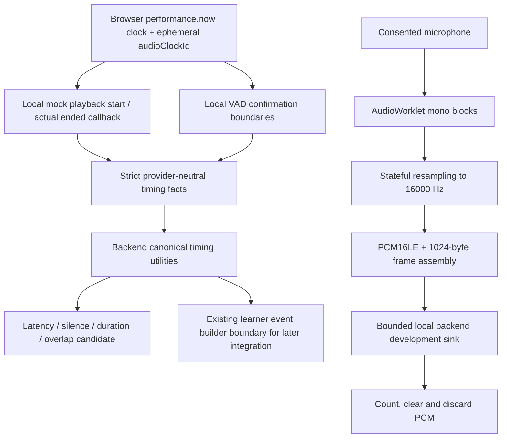

# Browser audio instrumentation — Phase 4B

Phase 4B adds an optional **development-only** microphone check to the existing live-call screen. Typed mock turns still drive the session engine. There is no browser-to-provider connection, production STT orchestration, Timbre, acoustic behavior/filler detection, or automatic policy change.

## Two independent paths

## Consent, lifecycle and cleanup

Nothing requests a microphone on application load, dashboard navigation or scenario inspection. The learner first grants the existing simulation consent, then checks a separate microphone confirmation and clicks **Prepare microphone**. The confirmation starts unchecked for each mounted page/turn, including after reload. Browser permission alone never starts capture automatically.

States are `IDLE`, `PERMISSION_REQUIRED`, `REQUESTING_PERMISSION`, `READY`, `CALIBRATING`, `LISTENING`, `SPEECH_ACTIVE`, `STOPPING`, `STOPPED`, `PERMISSION_DENIED`, `DEVICE_UNAVAILABLE`, and `ERROR`. READY means the stream/context resources are acquired; calibration must finish before caller playback or response measurements.

The controller owns tracks, context, processor port, resampler, assembler, VAD, deadline and forwarding queue. End, typed-turn submission (including the safe word), unmount/navigation, observed consent withdrawal, device loss, processor/context failure and hidden/suspended pages stop resources. Tracks stop synchronously without waiting for the backend. A generation guard ignores late permission, playback and network results. An abort signal also releases an acquired stream while worklet setup is pending. Stop is idempotent. On expiry during calibration, the check stops without manufacturing a timing result.

## Audio processing

Requested constraints: mono, echo cancellation, noise suppression and automatic gain control. `getSettings()` is inspected through a whitelist of numeric/boolean technical fields; labels and device IDs are neither displayed nor retained. The **AudioContext** sample rate drives DSP, independently of the optional reported input-track rate. Unsupported secure-context, media or AudioWorklet capabilities fail with a sanitized typed error. No deprecated ScriptProcessor fallback is added.

The standalone JS worklet is served through Vite's asset URL handling. It averages channels, accumulates 20 ms native-rate blocks and transfers them to the controller. At most eight unacknowledged blocks are allowed. The main thread clears samples after processing and acknowledges each block. React receives metadata at most ten times per second, plus lifecycle/boundary transitions.

The streaming area-average resampler retains weighted partial samples and absolute input/output counters across chunks. It supports noninteger ratios, including 44100→16000, without independent-chunk rounding drift. Its small box filter has limited stopband rejection; it is an instrumentation implementation, not a high-fidelity DSP or telephony claim.

Float samples are clamped to [-1,+1], scaled to signed Int16 and explicitly written little-endian. Complete frames contain 512 samples / 1024 bytes / 32 ms. **Finish check** flushes the worklet's partial block (bounded 100 ms acknowledgement), pads a final fractional resampler sample with silence, then zero-pads any incomplete PCM frame. Padding counts are visible. No provider EOS message or new trailing-partial behavior is invented. Hard stop/error intentionally discards pending audio immediately; it does not try to flush or generate a speech-end event.

## Local VAD

Defaults in `audio/vad.ts`:

| Setting | Value |
|---|---|
| Ambient calibration | 750 ms of processed audio; caller cue disabled |
| Noise estimate | Duration-weighted lower quartile during calibration |
| Speech-on threshold | clamp(noise floor ×3, 0.012, 0.25) RMS |
| Speech-off threshold | speech-on ×0.6 |
| Activation debounce | 80 ms |
| Minimum confirmed speech evidence | 120 ms; both activation requirements must be satisfied |
| End hangover | 300 ms continuously below speech-off |
| Quiet-floor adaptation | Slow update only below speech-off |

One impulse or an interrupted subminimum burst cannot start a segment. Hysteresis and hangover keep short pauses inside a segment. Start/end times are **confirmation times on the browser clock**, not exact acoustic phoneme boundaries: start includes confirmation delay; end includes hangover. A stopped active segment has no fabricated speech end. Energy VAD cannot identify the learner, reject all noise, distinguish speaker bleed, count words, infer emotion or establish formal speech accuracy. High/background noise, browser processing and gain control can alter thresholds; physical-device QA remains necessary.

## Clock domains and canonical facts

Each capture window gets a random ephemeral `audioClockId` and one `performance.now()` origin. Caller cue start, actual `AudioBufferSourceNode.ended` receipt, VAD boundaries and frame production all read that same clock. AudioContext time is not subtracted from it. The local cue is a three-second nonlinguistic 440 Hz test signal, because existing mock TTS returns no playable audio. It never plays draft scenario text or requests synthesis.

Strict facts carry session ID, next turn number, event kind, local instant, clock ID, source, segment number where applicable and availability. They carry no PCM, transcript, provider time or arbitrary metadata. The backend validates identity, source roles, event ordering and start/end pairing. Browser clocks are not converted to or subtracted from server clocks. Clock IDs prevent combining different pages/tabs/capture windows. Legacy mock fixtures remain supported; a clock-tagged instant cannot be paired with an untagged backend/fixture instant.

`captureBrowserAudioTiming` maps validated facts into the existing `CapturedAudioTiming` boundary. The preview calls existing `deriveResponseLatency`, `deriveHesitation`, `deriveElapsed`, and `detectInterruption`; React implements none of these formulas. Overlap produces null response latency and null pre-speech silence. No speech produces unavailable values. A hidden page, suspended context or processing gap greater than250 ms stops capture and invalidates timing. Provider timestamps remain reference metadata only.

The existing learner event builder accepts the mapped timing and enforces the browser interruption gate. It continues to own transcript-based word counts, filler evidence, speech rate and the fixed first-valid-turn baseline. Actual transcript-to-turn/debrief integration is deferred to Phase 4C; diagnostic checks do not append empty or fabricated learner turns.

## Development forwarding and security

`POST /api/sessions/:sessionId/audio/{start,frame,finish,cancel}` exists only in development/test. Requests require loopback access and Host, a matching Origin when supplied, eligible session state and granted consent. Use the existing same-origin Vite proxy; no cross-origin browser streaming route is introduced. Start issues an ephemeral window token bound to session, next turn and browser clock. The token is an in-memory development capability, not a provider credential.

Limits: the existing limiter permits twelve audio starts per minute per local address; one window per session, sixteen windows globally, sixty-second server expiry, fifty-five-second client capture deadline, at most1876 frames/window, exactly1024 bytes/frame, strict ascending sequence, and one in-flight server frame request. Facts are capped at128 events and49,152 request bytes. Browser forwarding permits eight frames including its in-flight request, uses a two-second request deadline, and never retries. Backpressure stops the check, surfaces a technical error and clears queued buffers. End/turn requests cancel existing development windows. Consent/turn/expiry are rechecked after asynchronous reads.

The sink clears incoming PCM chunks immediately and stores only counts, expiry and identity. It has no provider call, disk/database/cache/analytics write, audio log or transcript retention. Fetch and response caching are disabled. Invalid binary length/type/sequence is rejected; arbitrary 16-bit sample bit patterns are valid PCM and do not establish speech or correctness.

## Completed development check

Graceful Finish enters `FINISHING`, performs the existing bounded flush, releases capture resources and transient PCM, then waits for the existing validated `BrowserAudioSummary`. Success enters `COMPLETED` and retains safe local technical facts plus the immutable backend summary. The panel visibly displays completion and separate local produced/backend received counts; unavailable timing stays unavailable. Duplicate Finish and new Prepare are blocked during finishing. Explicit new Prepare clears the old measurements. Repeated cleanup after success preserves the result. Emergency Stop cancels and stays `STOPPED`; cancellation wins over a late Finish response. Invalid or failed Finish responses enter `ERROR` with safe local diagnostic facts retained. See [finish-render correction evidence](../evidence/browser-audio-finish-ui.md).

## Echo and interruption gate

The UI distinguishes echo cancellation **requested**, **reported applied** (or unknown), and speaker bleed **validated**. Reported application is not proof of successful cancellation. `speakerBleedValidation=UNKNOWN` and `interruptionReportingEnabled=false` are server-owned fixed defaults in Phase 4B. There is no checkbox that promotes QA to PASSED. Overlap candidates are diagnostic only; learner-facing interruption claims remain unavailable. Headset, speaker-silence and true overlap evidence must be collected before any later phase enables reporting. A tone test alone cannot validate speech-shaped caller bleed.

See [Phase 4B evidence and manual procedure](../evidence/browser-audio-phase4b.md).

API references: [AudioWorkletNode](https://developer.mozilla.org/en-US/docs/Web/API/AudioWorkletNode), [track settings](https://developer.mozilla.org/en-US/docs/Web/API/MediaStreamTrack/getSettings), [scheduled-source ended event](https://developer.mozilla.org/en-US/docs/Web/API/AudioScheduledSourceNode/ended_event). No cross-browser production compatibility is claimed.
