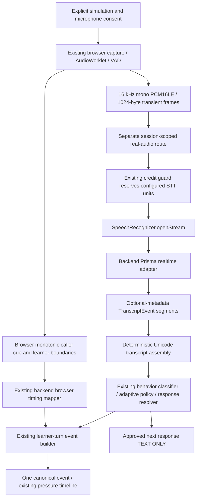

# Phase 4C.1: one real STT learner-turn path

## Phase4C.2 caller extension

The first learner-turn boundary remains. An explicit real-caller checkbox loads the approved opening through backend Timbre/cache before mic/STT opening, then plays after calibration. Actual playing/ended enter the shared browser/VAD clock; mock cue remains available. Finish retains text/policy and adds optional selected-response audio availability. Selected playback uses the same service/player, without another learner turn. Participant synthesis is verified once; physical caller-playback/learner-timing acceptance is pending. See [Phase4C.2 evidence](../evidence/phase4c2-real-caller-voice.md). Earlier Phase4C.1 sections remain historical.

Implementation date: 2026-10-13; acceptance preflight updated2026-10-14. Runtime wiring is opt-in and local-development-only. **Canonical S-01 v0.2.0 hi-IN content is approved and runtime eligible; physical live acceptance remains pending.** The prior draft and pending review are archived outside runtime/catalog loading. See [implementation/evidence report](../evidence/phase4c1-real-turn.md).

## Interfaces and composition

`SpeechRecognizer.transcribe` remains available to existing mock callers. Its optional provider-neutral `openStream` extension returns `ready`, `sendFrame`, `finish`, and `cancel`. Session/turn code consumes that interface. Only API composition selects `PrismaRealtimeSpeechRecognizer`. Application code does not call Phase 4A scripts or depend on the verification parser. The runtime parser separately implements the observed `connected`, `speech_start`, and `transcript` shapes and a safe provider error boundary. Unknown events, including unverified `processing`/`speech_end`, fail closed with bounded typed diagnostics.

API startup loads the existing root `.env`. `PRISMA_RUNTIME_ENABLED=true`, a locally configured `GNANI_API_KEY`, positive `STT_COST_UNITS`, and capacity under the existing project credit guard are required. Default is disabled; absent runtime configuration leaves mock startup/build/tests working. The verified participant baseline is fixed in backend configuration: `wss://api.vachana.ai/stt/v3/stream`, `x-api-key-id` from `GNANI_API_KEY`, `lang_code=hi-IN`, and `x-sample-rate=16000`. No alternate endpoint, optional tuning header, finalness option or frontend credential was added. Root `.env` is not modified or committed.

Configured credit reservations are conservative, shared with the existing STT guard in the API process, and are not refunded automatically after failed attempts. They are abstract project units, not Gnani billing measurements or a durable account ledger. Restarting the process does not reconcile account usage.

## Runtime API and eligibility

Create an explicitly consented session using the existing session endpoint with `runtimeMode: "REAL_STT"`, `demoMode: false`, approved S-01 version, and `language: "hi-IN"`. `runtimeMode` defaults to `MOCK` for compatibility. Creation rejects draft content, other scenarios/languages, missing adaptive policy and non-development/test use. The first caller response/tactic/pressure come from the approved root response and its scenario mapping.

The separate `/api/sessions/:sessionId/real-audio/` route provides:

| Action | Behavior |
| --- | --- |
| GET `status` | Safe availability reason and approved opening text; no provider connection |
| POST `start` | Existing clock/next-turn identity plus literal `microphoneConsent: true`; validates session consent, first-turn mode and content, reserves credit, opens one provider stream, waits for `connected`, returns ephemeral token |
| POST `frame` | Header token, ascending sequence and browser production instant; accepts exactly 1024 binary bytes, forwards one transient frame and zeros it after acknowledgement |
| POST `finish` | Validates existing browser timing facts against session/turn/clock; finalizes transcript, runs existing intelligence once, returns safe result and counts |
| POST `cancel` | Immediate stream cancellation and token disposal; does not advance a turn |

The route requires loopback peer/Host and matching Origin when supplied, and uses the same-origin development proxy. Tokens are random, session/turn/clock-bound and carried in a header. There is one window per session, at most four globally, one frame request in flight per window, a start rate limit, and bounded frame/body sizes. Nonlocal/public runtime use is unavailable. Typed mock turns are rejected in REAL_STT sessions. Only turn 1 is allowed; no full multi-turn loop is activated.

## Browser lifecycle and cleanup

The existing controller, worklet, resampler, PCM assembler, queue and standalone-fetch receiver handling are reused. The development discard route and completed QA summary remain separate. Runtime options automatically play the existing three-second mock **tone cue** after quiet calibration, then finish on local VAD end. Capture is open before playback so both caller and learner instants share one clock and overlap can be represented. Actual cue start/ended callbacks are recorded; displayed approved text is not claimed to have been spoken. No Timbre is used.

`FINISHING`/`COMPLETED` behavior is preserved. Capture resources are released before awaiting backend transcription. Duplicate Finish calls cannot submit twice. Generation guards reject late frames, timers and completion callbacks. End simulation stops both microphone controllers synchronously, then cancels the server stream/session. A safe-word recognized in the completed transcript uses existing safe policy semantics; the explicit End control remains the immediate stop.

## Bounded provider lifecycle

Central limits live in `REAL_TURN_LIMITS` and can be overridden in adapter tests:

| Limit | Value |
| --- | --- |
| Provider connection | 5 s |
| Provider send | 1.5 s |
| No local speech after cue end | 10 s |
| Client capture window | 30 s |
| Total provider/server window | 45 s |
| Maximum browser frames | 1000 |
| Browser queue including in-flight | 8 frames (existing Phase 4B bound) |
| Backend silence before settling | 2016 ms, exact 1024-byte zero frames paced at 32 ms |
| Transcript settle | 3 s |
| Requested close | Code 1000, 1 s deadline |
| Browser start / finish request | 6.5 s / 8.5 s; ordinary frames retain 2 s deadline |

The silence/drain strategy follows the tested Phase 4A approach. It establishes an application window boundary, not provider finalness/EOS semantics. There are no retries/reconnections. Connection, socket, early-close, malformed/unknown event, backpressure and timeout failures terminate the stream. A cancelled window cannot continue classification or event append. Cancel/end, completion, failures, expiry and server closure dispose tokens and timers. A start acknowledgement lost before the browser receives its token remains bounded by the server expiry.

## Segments, timing and event authority

`TranscriptEvent` now optionally carries provider-neutral `segments`. Provider timestamps, segment IDs/indexes, audio duration and latency are optional reference metadata. Text is Unicode-preserving; only whitespace is trimmed/collapsed. No translation, transliteration, LLM rewriting or `final=true` field is introduced.

Known segment indexes retain their relative order. Metadata-free emissions retain arrival slots. Identity/index duplicates with the same text are deduplicated; conflicting text for the same identity fails safely because replacement semantics are unverified. Without identity/index, repeated equal text with equal optional timestamp is conservatively deduplicated; indistinguishable legitimate repetitions can therefore be lost. Collection is bounded to 64 segments/8192 segment text characters. One assembled response is classified once, regardless of segment count.

The existing classifier keeps uppercase labels and `UNKNOWN`. Hindi/Latin/mixed-script representations are passed through to its existing rules; unsupported wording stays unknown. Runtime dummy disclosure accepts only whole `DUMMY-\d{4}` tokens. Legacy named mock fixtures remain supported solely on the old mock path. The existing compliance detector gained this exact numeric dummy format; it still rejects real-looking arbitrary numeric secrets. Compliance remains approximate segment-level evidence using relevant provider segment identity and browser turn context, with no word timing.

After user-reported live Attempt1 exposed Devanagari English-loanword coverage, verification matching gained one internal Unicode/token/alias layer. Attempt2 reportedly succeeded; Attempts3/4 then exposed overly broad rejection negation and missing phonetic-English aliases. The offline follow-up maps bounded `आई`/`विल`/`वेरिफाय` and related native/mixed forms to existing learner/future/action concepts. Only an initial standalone rejection immediately followed by explicit first-person SELF gains the REJECTION role; later/action negation still vetoes verification, including across a comma. Learner-controlled independent or official/known-channel action is still required; caller instructions/participation, handover and questions remain exclusions. Successful scope and matched concepts are inspectable through existing evidence IDs. No sentence matching, translation or full transliteration is used; actual provider/UI text remains unchanged. Dummy-disclosure-first precedence, other labels, policy, provider parsing, scenario approval and timing are unchanged. Two targeted physical checks A + B remain pending; see [the full observation history and follow-up](../evidence/phase4c1-real-turn.md#classifier-robustness-correction--offline-2026-10-18).

Local browser timing facts feed `captureBrowserAudioTiming` and the existing canonical event builder. Response latency is browser learner-start minus browser caller-end within the same `audioClockId`; overlap leaves latency null. Whole-turn speech duration uses the first local start and last available local end. Provider time/duration cannot supply those values. Speech rate, filler rules and fixed session baseline logic are unchanged. Interruption reporting remains gated/unknown. Provider connection and first-transcript elapsed times use a separate backend service clock; first-transcript elapsed time includes capture, not solely provider processing.

Final preflight corrected VAD boundary semantics without retuning: start is estimated at the first qualifying block's beginning, end at the last active block's end; confirmation still waits for the existing evidence/hangover windows. Facts are ordered by those browser-clock boundaries across caller callbacks. Block timing derives from callback monotonic time/duration and is not a hardware timestamp. A complete multi-segment response spans first start to the final segment end, including pauses. If the final segment has no end, canonical whole-turn duration is unavailable rather than borrowed from an earlier segment. Development diagnostics explicitly show latest-segment values. Six offline regressions cover these semantics.

The orchestrator reuses existing classifier, policy, approved response resolver, event builder, append function and pressure timeline builder. The selected response is returned as text, without cache/TTS calls. Event evidence includes `input.prisma_runtime`. Caller pressure records the scenario's active opening pressure; selected next pressure records the policy decision. No additional fake events are appended.

## Privacy and phase boundary

Raw audio exists only in bounded transient capture/HTTP/WebSocket buffers and is zeroed/released after use. No PCM, buffers, credentials or arbitrary provider errors enter session events, browser persistence, logs or evidence. Existing returned-transcript redaction also applies to returned segment text. Development UI may display the safe transient transcript and approved response; no transcript is added to the event log.

Phase4C.1 has **four user-reported live attempts**: initial UNKNOWN, corrected VERIFIED_INDEPENDENTLY/SAFE_VERIFIED, then UNKNOWN for leading rejection and phonetic English. Exact text is available only for Attempt1; later omissions are preserved in the evidence report. The latest classifier correction is offline; completion requires the two targeted physical checks and cleanup evidence. Synthetic fixtures remain test-only; normal runtime loads the human-approved canonical content. Phase4A/4B evidence history remains unchanged. Phase4C.2 Timbre and Phase4C.3 full multi-turn/end/debrief work are not implemented here.

## Phase 4C.3 accounting correction — 2026-10-20

The preceding sections retain the 4C.1 phase boundary. The current automatic runtime supports up to three bounded turns; the actual Prisma adapter now accepts integer turns 1–3 with its existing wire contract. A local `openStream` rejection before returning a transport releases its one held STT reservation. Once transport is attempted, failure/cancellation retains that unit conservatively. No Finish/classifier/policy/event/debrief charge is added.

`TurnOrchestrator` owns `RuntimeCreditLedger`: separate process-wide runtime STT/TTS counters plus isolated mock simulation accounting. Usable capacity is `max(0, cap - reserve)` independently for each operation; pending reservations are already included in used units. Runtime STT initializes to server budget zero, TTS to the configured honest prior-use seed. No file/session balance, automatic env write-back or account-billing reconciliation exists. Restarting loads configuration and initializes this finite process allocation; it does not restore provider credit.

Caller audio resolves approved content and cache first. HIT spends zero. On MISS the real Timbre adapter validates locally, checks cancellation and invokes its optional provider-neutral `beforeRequest` hook immediately before fetch. An idempotent ticket reserves one configured TTS cost; attempted failures/cancellations retain it, pre-request local failures do not consume it. Existing in-flight coalescing and no-retry behavior remain. Endpoint, language, voice, DSP and local timing are unchanged. See [the complete accounting audit and physical retry boundary](../evidence/phase4c3-multiturn-s01.md#complete-credit-and-caller-failure-audit--2026-10-20).

## Phase 4C.3 persistent microphone and turn re-arm — 2026-10-20

Automatic conversation keeps one granted MediaStream, AudioContext, AudioWorklet and local session clock. Microphone acquisition still requires the explicit start gesture. During caller playback/backend processing, the driver acknowledges and zeros/discards native samples without forwarding learner PCM.

After actual caller end and its acknowledgement, one orchestrator calibrates the next learner turn. ReusableMicrophone checks stream/track/context/worklet health and sequential turn identity, drains queued/partial samples with `flush({ keepAlive: true })`, then attaches a fresh LocalVad. The learner controller creates a fresh resampler/frame assembler and sequence-zero window using the same clock origin/ID. No VAD or DSP settings change. Duplicate calibration/leases and stale callbacks fail or become inert using mode/epoch ownership.

The nonterminal worklet command `flush-turn` emits/zeros the partial tail and keeps processing. Learner finalization uses that command and detaches only the turn callback; session tracks/context/worklet remain live. Default `flush()` retains the standalone Phase 4B terminal command. End, navigation, terminal completion/decision, safe word and fatal failure perform full session cleanup exactly once. No closed context is resumed or ended stream blindly reused.

Strict local technical causes distinguish unavailable stream/context/worklet, reentrant/invalid turn, calibration timeout and invalid input. Mode/turn/calibration count and safe resource states appear in development Technical audio facts. A failed second calibration preserves earlier committed events and partial debrief and opens no next provider window. See [the physical blocker, exact terminal-flush cause and offline tests](../evidence/phase4c3-multiturn-s01.md#second-turn-learner-re-arm-and-calibration-blocker--2026-10-20).
