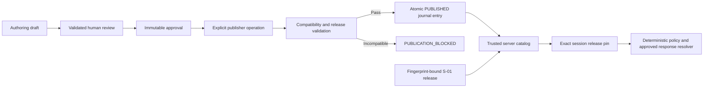

# Trusted runtime content

The backend builds its executable catalog from the protected S-01 release and successful publications in the existing local review journal. The learner API accepts a scenario identity, exact version, mode, language and optional voice selector. These fields select a release. They carry no approval authority.

The runtime uses the existing journal reader with bounded UTF-8 and JSON parsing, file identity checks, sequence and hash-chain validation, actor-policy checks and immutable approval checks. A successful publication embeds the compiled package in the same atomic commit as its audit events. The reader verifies package, approval, review and source hashes, recomputes current safety validation, and recompiles the package from the approved snapshot. A hold removes that version from the executable catalog. Both `PUBLICATION_REQUESTED` and `SCENARIO_PUBLISHED` are required in the successful commit. Blocked attempts retain their own audit entries.

The runtime reads no files in the authoring draft cache. The journal replay reads immutable review records for integrity and projects only verified, unheld successful releases. The runtime server uses fixed paths and fingerprints for the legacy S-01 scenario and its existing approval package. The package and scenario must agree and pass the release and safety validators. The historical S-02/S-03 entries have their own fixed fingerprints and only supply the pre-existing metadata-only mock fallback. Learner-facing source cards display their fallback status separately from the executable catalog. A server-side test fixture override remains restricted to the test environment and is inaccessible from HTTP.

## Supported release profiles

`current-real-conversation` retains the established S-01 `hi-IN` Prisma/Timbre path, including the existing voice profile, terminal behavior and debrief templates. The legacy release has no fabricated publication ID. Its pinned package hash refers to the historical approval package. Provider resources are reached through existing consent, local runtime and credit guards after the content gate.

`offline-adaptive` is the explicit Phase 6D publication target for typed practice. An authored candidate opts in with `details.runtimeProfile = "offline-adaptive-v1"` before review, so the reviewed hash covers that decision. The existing engine supports one safe ending for independent verification, dummy disclosure and max turns, plus a separate fallback. All three outcomes must explicitly reference the same authored `system.safe-ending`. The compiler uses the unchanged policy and resolver over every reachable behavior branch and checks response ID, next pressure, terminal outcome, context and turn bound. It preserves text, response IDs and the authored pressure ceiling. The `mock-only` delivery profile provides typed input and mock synthesis without opening a microphone or live adapter. The package distinguishes source content hash, approval artifact hash, runtime package hash and journal commit hash.

## Sessions and withdrawal

`GET /api/runtime/scenarios` projects executable releases for the browser. The session endpoint independently applies the same authority to the selected version and rejects stale or unavailable requests. Every approved session pins a publication ID where applicable, package hash and policy version. The session stores and event projections retain the scenario and version, terminal outcome and session ID. For published typed sessions the immutable package supplies a private scenario map to the existing turn pipeline. Publishing a newer version cannot change an active session's map.

On resume and active requests the server checks the pin against current authority. Held, missing, corrupted or stale releases stop the session through existing End handling. The typed pipeline checks publication again at mock synthesis and before returning output. The legacy voice path verifies its pinned release before opening, finalizing or serving audio. PCM frame writes use the existing pinned window and get checked at finalization, avoiding repeated disk reads for every frame. A hold is enforced on the next guarded request. Work admitted before a concurrent filesystem change may have begun, and a completed provider request cannot be recalled. Session state remains process-local. A restart reloads the release journal and rejects old session IDs.

The trust boundary is the configured workspace and local OS account that owns the CLI and journal. Hashes detect corruption and bind references. An OS user who can replace trusted code or rewrite the entire journal and actor policy controls that trust boundary. The runtime exposes no mutation endpoint for approvals, publications or holds. Denial diagnostics contain bounded scenario identity, timestamp and typed error code.
