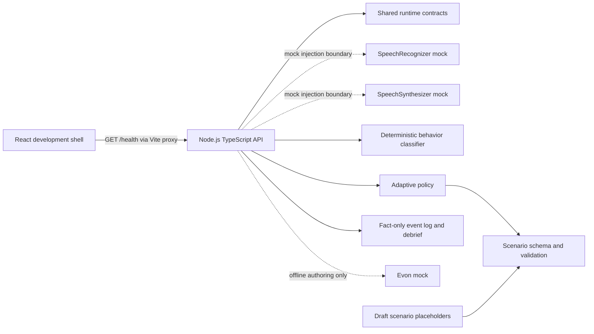

# System overview — Phase 2A foundation

## Current boundary

The local flow includes explicit consent, in-memory session state, a text-only mock turn endpoint, deterministic behavior classification, an adaptive policy boundary, approved response references, safe fallback metadata, and a privacy-conscious turn-event timeline. The learner microphone/voice loop and real integrations are not implemented. Draft scenarios remain barred from adaptive tactic playback.

## Intended later runtime

The live design is learner audio → local timing/VAD → backend-proxied realtime STT → normalized `TranscriptEvent` → deterministic behavior classification → adaptive policy → approved tactic and response reference → cache/TTS → caller playback → event log. It has no unconstrained live LLM. A session-local monotonic clock owns caller playback and learner speech timing. Raw learner audio is transient and is not represented in session state.

Scenario authoring remains an offline content pipeline: brief → draft → safety validation → human review → approved scenario/tactic pool → optional pre-generated artifacts. Draft content cannot be selected as an adaptive tactic; local draft sessions use only the generic system-safe fallback. Evon remains offline authoring and absent from runtime decisions.

## Local services

- API: Node HTTP server on loopback (`127.0.0.1:3001` by default); `/health` and `/api/sessions` expose the local development flow.
- Web: Vite + React; `/health` and `/api` are proxied to the API during development, avoiding browser-side provider credentials and a separate CORS configuration.
- Session storage: in-memory only. In-memory session storage is currently a development implementation. Production persistence choice remains intentionally deferred.
- Build: workspace packages compile before API/web packages so their declared package exports resolve from generated `dist` output.

The web bundler transpiles TypeScript but does not replace `tsc` type checking; the repository runs both. See Vite's [TypeScript feature guide](https://vite.dev/guide/features.html#typescript).
