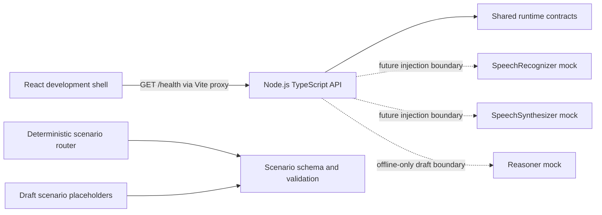

# System overview — Phase 1

## Current boundary

The local flow now adds explicit consent, in-memory session state, a text-only mock turn endpoint, deterministic routing, safe fallback metadata, and turn-level debrief events. The learner microphone/voice loop and real integrations are not implemented. Draft scenarios are still barred from approved branch playback.

## Intended later runtime

The roadmap's intended direction is microphone/input → backend → speech-recognition adapter → normalized `TranscriptEvent` → deterministic router → approved response ID → TTS cache or synthesis adapter → caller audio → turn-based debrief. Audio inputs are transient byte buffers and are not represented in session state. Persisting learner audio is outside this design.

Scenario authoring remains an offline content pipeline: brief → draft → safety validation → human review → approved tree → optional audio pre-render. Draft content cannot be selected as an approved runtime branch; local draft sessions use only the generic system-safe fallback. Live Evon remains disabled by default and absent from runtime decisions.

## Local services

- API: Node HTTP server on loopback (`127.0.0.1:3001` by default); `/health` and `/api/sessions` expose the local development flow.
- Web: Vite + React; `/health` and `/api` are proxied to the API during development, avoiding browser-side provider credentials and a separate CORS configuration.
- Session storage: in-memory only. In-memory session storage is currently a development implementation. Production persistence choice remains intentionally deferred.
- Build: workspace packages compile before API/web packages so their declared package exports resolve from generated `dist` output.

The web bundler transpiles TypeScript but does not replace `tsc` type checking; the repository runs both. See Vite's [TypeScript feature guide](https://vite.dev/guide/features.html#typescript).
