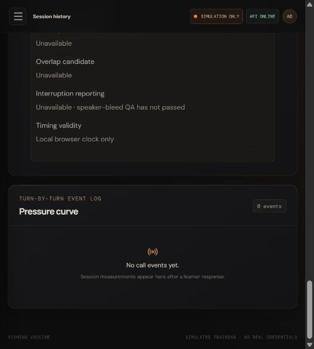

# Phase 4B — browser audio evidence and manual QA

Date: **2026-10-11**. **PHASE 4B STATUS: COMPLETE (implementation and deterministic validation).** Physical microphone QA: **NOT EXECUTED**. This follows the task's explicit fallback for automation that cannot reliably perform microphone QA; it is not a hardware pass or an accuracy/reliability claim. Interruption reporting remains disabled, with speaker-bleed validation UNKNOWN. Phase 4C is not implemented.

## What is established

- Consent-gated browser microphone controller, lightweight standalone AudioWorklet, technical-settings whitelist and explicit permission/error states.
- Stateful mono resampling, PCM16LE conversion and complete1024-byte frames with bounded transient forwarding to a development backend discard sink.
- Calibrated energy VAD with confirmation boundaries, one browser performance clock per ephemeral clock ID and a local mock playback lifecycle.
- Backend previews reuse canonical timing utilities. A typed mapper feeds the existing learner-event builder boundary; actual transcript/policy/debrief integration remains for Phase4C.
- No provider request was made in this phase. No learner audio was recorded, persisted or used in automated tests.

## Environment and observation limits

| Item | Actual observation / configuration |
|---|---|
| Browser used | Codex in-app browser for UI-only smoke check; engine/version not recorded |
| OS | Windows host; version not recorded |
| Input device category | NOT OBSERVED — microphone was not opened |
| Requested constraints | channelCount1, echoCancellation true, noiseSuppression true, autoGainControl true |
| Applied track settings | NOT OBSERVED; UI initially displays unknown/empty settings |
| AudioContext source rate | NOT OBSERVED on physical hardware; detected dynamically at runtime |
| Deterministic source-rate fixtures | 8000,16000,44100,48000 Hz; noninteger/chunk continuity and long-run count tests |
| Target format | Raw mono signed PCM16LE,16000 Hz,1024 bytes/frame |
| VAD configuration |750 ms calibration; noise×3 bounded0.012–0.25 RMS; off/on0.6;80 ms debounce and120 ms minimum consecutive evidence;300 ms hangover |
| Headset caller-silence test | NOT EXECUTED |
| Speaker caller-silence test | NOT EXECUTED |
| Real learner-over-caller test | NOT EXECUTED; synthetic overlap tests pass |
| Actual mic-indicator cleanup test | NOT EXECUTED; injected lifecycle/resource cleanup tests pass |
| Interruption reporting gate | Disabled; UNKNOWN bleed validation, independent of requested/reported echo cancellation |
| Physical audio sessions | **0** |
| Live provider attempts | **0** |

The available automation verified UI states but cannot establish controlled learner speech, headset/speaker routing or an acoustic bleed result. No microphone permission prompt was accepted. UI smoke observations: initial session consent gate; separate unchecked mic confirmation and disabled Prepare button; PERMISSION_REQUIRED state; unavailable rate/boundaries/metrics before capture; unknown applied echo cancellation; interruption unavailable; ending the local test session navigates to debrief, and revisiting its live route shows STOPPED with controls disabled. Two temporary local mock sessions were created/ended; neither captured audio. Screenshot records the stopped-state interruption gate, not audio performance.

## Automated validation

Canonical command: `npm run check`. **201/201 tests pass**, with typecheck, ESLint, all3 draft scenario validations, API/web production builds and secret scan passing. The original156 tests are preserved;45 deterministic tests were added. Normal validation makes no provider calls and needs no physical microphone.

Coverage includes:

- PCM endpoints, clipping, endian bytes, channel downmix, native/target rates, fractional resampler continuity,100-second44100 Hz drift check, exact frames and final padding.
- Calibration, quiet/noisy amplitude fixtures, impulse/subminimum rejection, sustained activation, hysteresis, short/long pauses, hangover and slow quiet-floor adaptation.
- Permission denial/device failure, late permission results, capture/calibration/listening/speech/stop, double stop, consent loss, fatal errors, processing gaps and post-stop suppression.
- Same-clock backend latency/silence/duration, overlap with null latency, no speech/missing boundaries, reload clock separation, provider/server clock rejection and strict fact privacy.
- Existing learner-event builder and speech-rate baseline with browser interruption reporting disabled.
- Local HTTP PCM arrival/counts/discarding, consent/session/window/token checks, malformed lengths/type/sequence, cross-origin and rebound Host rejection, production gate.
- Bounded forwarding queues, failure cancellation/no retries, worklet mono blocks, partial flush, acknowledgement/backpressure and standalone Vite module serving.
- Structural no-storage/no-logging/no-provider checks and SSR diagnostic consent/gate rendering.

An initial focused run's local HTTP tests were blocked by the execution sandbox; the same tests passed with loopback access. The first canonical run caught a test imported across the API TypeScript root; moving that integration test into the existing web test boundary fixed it. These were validation/environment issues, not live provider attempts. Final result above is the full successful canonical run.

## Exact manual procedure — no recording required

1. In two terminals at the repository root run `npm run dev:api` and `npm run dev:web`. Open the Vite URL in current Chrome/Chromium on localhost/127.0.0.1. Use the existing Vite proxy; do not configure a direct provider endpoint in the browser.
2. Choose **Start training**, review the simulation disclosure, check consent and click **Start simulation**. In **Development audio check**, confirm the separate microphone statement. Do not enable fixed timing fixtures while interpreting microphone diagnostic results.
3. Click **Prepare microphone**, grant the normal browser prompt yourself, remain quiet for750 ms, then expand **Technical audio facts**. Record browser/version, OS, input category only, source rate and whitelisted reported settings. Do not copy a device ID/label or record audio. Expect LISTENING after calibration. Caller cue must remain disabled during calibration.

Run each check in a fresh prepared window as needed. Each window ends automatically at55 seconds, and the server expires it at60 seconds. Finish waits only for bounded local flushing/forwarding; Stop mic now discards pending audio immediately. Use headphones where possible.

| Check | User action | Evidence to record |
|---|---|---|
|1 — Permission / stop | Prepare, allow, then **Stop mic now** | State transitions; browser mic indicator turns off; denied permission gives a clear state and manual retry only |
|2 — Silence | Stay quiet for5 seconds after calibration; **Finish check** | No speech boundaries; duration/latency unavailable, no fake zero values |
|3 — Normal speech | Say a benign sentence, then stay quiet >300 ms; finish | One confirmed start/end, plausible duration, backend frame count greater than0 |
|4 — Short speech | Say “okay”, then wait >300 ms; finish | Local VAD start/end present for this specific input; report a miss honestly |
|5 — Short pause | Speak, pause about150 ms, continue | One segment with this300 ms hangover configuration |
|6 — Two utterances | Speak, pause >500 ms, speak again | Two segments/start/end pairs |
|7 — Delayed response | Play the3-second **mock caller cue**, wait for completion, then speak | Positive backend response latency and pre-speech silence, same browser clock |
|8 — Early response | Prepare again; speak while the cue is playing, let cue finish, then finish check | overlapCandidate true; response latency/silence unavailable; interruption still unavailable |
|9 — Headset bleed | Route cue through headset, remain silent | Whether VAD falsely activates; record headset category, not identifiers |
|10 — Speaker bleed | Route cue through laptop speakers, remain silent, then repeat with actual overlap | False activation and actual overlap observations; do not promote QA to PASSED based on a tone alone |
|11 — Cleanup / suspension | Capture then end session, navigate away, or submit `stop simulation`; repeat by hiding the tab | Mic indicator off; no later frames/boundaries. Hidden/suspended timing must become unavailable |

Record actual results below without audio recordings. The local cue is nonlinguistic: speech-shaped caller bleed remains a later QA extension before interruption claims are enabled. Phase4B contains no gate promotion control.

| Manual result | Status | Notes |
|---|---|---|
| Permission/native rate/real capture | NOT EXECUTED | User device QA pending |
| Silence/normal/short/pause/two utterances | NOT EXECUTED | User speech and ambient conditions required |
| Delayed response/real overlap | NOT EXECUTED | Controlled acoustic test required |
| Headset/speaker bleed | NOT EXECUTED | Output routing and learner silence must be observed |
| Actual mic-indicator cleanup | NOT EXECUTED | Confirm in browser UI on the user device |

## Known limits and preserved boundaries

Energy activity is not learner identification. Noise, speakers and gain control can trigger it. Confirmation timestamps include120 ms start evidence and300 ms end hangover plus delivery/scheduling delay; they are not phoneme-level times. Background/suspension/gaps fail closed. The resampler's compact box filter has limited anti-alias rejection. Only local Chromium development is targeted; physical hardware and cross-browser compatibility are unverified. Production access control and the real browser→backend→Prisma runtime belong to Phase4C.

No frontend redesign, policy/behavior/debrief rewrite, authoring/dummy-secret change, provider clock authority, word-timestamp dependency, emotion inference, Timbre, live transcript integration, or learner-audio persistence was added. Credentials and `.env` stay server-only and unchanged; `.env` remains gitignored. Interruption claims stay unavailable until separate bleed evidence supports them.

## File inventory

Created:

- `packages/contracts/src/browserAudio.ts`
- `apps/api/src/browserAudioIngress.ts`, `browserAudioTiming.ts`, `browserAudioTiming.test.ts`
- `apps/web/src/audio/browserCapture.ts`, `capture.worklet.js`, `controller.ts`, `errors.ts`, `pcm.ts`, `transport.ts`, `useBrowserAudio.ts`, `vad.ts`
- `apps/web/src/audio/controller.test.ts`, `ingress.test.ts`, `pcm.test.ts`, `privacy.test.ts`, `transport.test.ts`, `vad.test.ts`, `worklet.test.ts`
- `apps/web/src/components/BrowserAudioPanel.tsx`
- `docs/architecture/browser-audio.md`
- `docs/evidence/browser-audio-phase4b.md`, `browser-audio-phase4b-ui.png`

Modified:

- `package.json` — append new offline tests; existing commands preserved
- `packages/contracts/src/index.ts`, `pressure.ts` — shared browser exports and optional clock identity
- `apps/api/src/health.ts`, `timing.ts`, `learnerTurnEventBuilder.ts`, `learnerTurnEventBuilder.test.ts` — dev ingress, clock pairing and gated builder reuse
- `apps/web/src/App.tsx`, `sessionApi.ts`, `styles.css` — existing live UI states/controls, forwarding factory and small diagnostic styling
- `docs/architecture/frontend.md`, `prisma-realtime-contract.md`, `provider-abstraction.md`, `session-api.md`, `timing-model.md`
- `docs/evidence/evidence-ledger.md`

No dependency or lockfile change.
